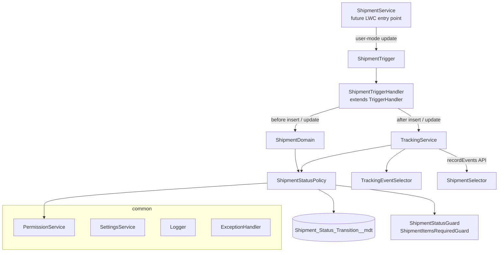
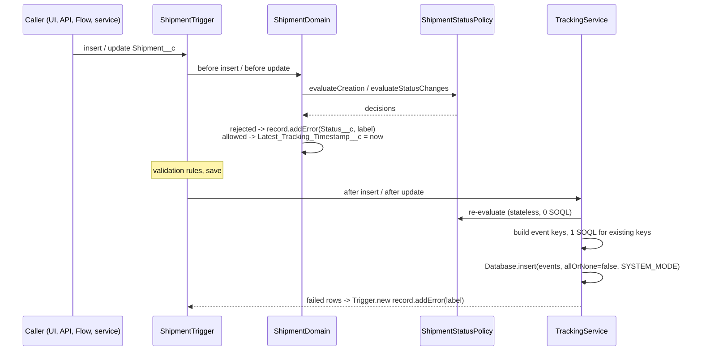

# eLogix ERP - Apex Architecture Contract (Phase 2)

|            |                                                                                                                                                                                          |
| ---------- | ---------------------------------------------------------------------------------------------------------------------------------------------------------------------------------------- |
| Status     | **Approved 2026-11-19, implemented and deployed** (deploy `0Afg700000KNnfeCAD`). Deviations from the approved text are listed in section 11.                                       |
| Scope      | Apex foundation, shipment status policy, tracking service, shipment trigger, tests                                                                                                       |
| Target org | `eLogixDev` (Developer Edition, source API 67.0)                                                                                                                                       |
| Related    | [SOLUTION_ARCHITECTURE.md](SOLUTION_ARCHITECTURE.md) · [SHIPMENT_LIFECYCLE.md](SHIPMENT_LIFECYCLE.md) · [BUSINESS_RULES.md](BUSINESS_RULES.md) · [SECURITY_DESIGN.md](SECURITY_DESIGN.md) |

This document is the interface agreement between the Phase 2 components. Signatures here are binding. Implementation may add private helpers, but must not change a public signature without updating this document.

## 1. Discovery findings (2026-11-19)

Facts verified in the repository and in `eLogixDev` (read-only queries) that shape the design.

| #   | Finding                                                                                                                                                                                                                                                                                                                                | Source                                                                 | Consequence                                                                                                                                                                          |
| --- | -------------------------------------------------------------------------------------------------------------------------------------------------------------------------------------------------------------------------------------------------------------------------------------------------------------------------------------- | ---------------------------------------------------------------------- | ------------------------------------------------------------------------------------------------------------------------------------------------------------------------------------ |
| F1  | The org has 0 Apex classes, 0 triggers, 0 custom labels.                                                                                                                                                                                                                                                                               | Tooling API counts                                                     | Greenfield; no naming collisions.                                                                                                                                                    |
| F2  | 46 active `Shipment_Status_Transition__mdt` rows. Blank `From_Status__c` = allowed initial status (Draft, Requested, Quoted). 3 rows require `eLogix_Cancel_Confirmed_Shipment` (Confirmed, Ready for Dispatch, On Hold → Cancelled).                                                                                           | SOQL on the CMDT                                                       | The policy reads `getAll()` (0 SOQL).                                                                                                                                              |
| F3  | `Shipment__c.Status__c` uses global value set `eLogix_Shipment_Status` (17 values, default Draft). `Tracking_Event__c.Event_Type__c` uses `eLogix_Tracking_Event_Type`, which has a same-named value for every status plus `Created`, `Exception`, `Picked Up`, `Hub Arrival`, `Hub Departure`, `Location Update`. | `elogix-datamodel.mjs`                                               | Every transition maps to a valid event type; the policy validates this at load time.                                                                                                 |
| F4  | `Tracking_Event__c` is master-detail to `Shipment__c`, has a unique external-ID `Event_Key__c` (80 chars), and a validation rule `TE_Events_Are_Immutable` (`NOT(ISNEW())`).                                                                                                                                                 | Model, validation rules                                                | Idempotency uses `Event_Key__c`; no new field is needed. Events can never be upserted or corrected, only inserted.                                                                 |
| F5  | `Tracking_Event__c.Event_Key__c`, `From_Status__c`, `To_Status__c` and `Shipment__c.Latest_Location__c`, `Latest_Tracking_Timestamp__c`, `Vehicle__c`, `Driver__c`, `Freight_Amount__c` are **protected**: read-only FLS for every role except Administrator.                                                    | `elogix-security.mjs`                                                | Tracking events are written by `TrackingService` in system mode (justified in section 6).                                                                                          |
| F6  | `Shipment__c.Item_Count__c` is a roll-up (count of items). Adding or deleting an item recalculates it, and **the parent shipment then goes through its save procedure, so `ShipmentTrigger` fires with no status change**.                                                                                                   | Platform order of execution                                            | The handler must exit cheaply when no status changed. Roll-up values are present in `Trigger.new`, so the item guard needs no SOQL.                                                |
| F7  | When a workflow field update or a partial-success DML retry re-runs triggers, `Trigger.old` still holds the values from before the **original** update, and static variables are **not** reset.                                                                                                                          | Apex Developer Guide (order of execution; bulk DML exception handling) | Static "already processed" flags would drop tracking events on retry. Duplicate suppression is done by a deterministic event key checked against the database instead (section 5.3). |
| F8  | Shipment validation rules already own: weight > 0, distance > 0, delivery after pickup, Delivered needs `Actual_Delivery_Date__c`, On Hold needs `Hold_Reason__c`, Cancelled needs `Cancellation_Reason__c`, origin ≠ destination.                                                                                              | `elogix-validation.mjs`                                              | Apex does not duplicate these (CLAUDE.md section 10).                                                                                                                                |
| F9  | Licenses: Salesforce 2 of 4 free, **Salesforce Platform 6 of 6 free**. Profile `Standard Platform User` exists.                                                                                                                                                                                                                | `UserLicense`, `Profile`                                           | Test users use `Standard Platform User` so tests never hit `LICENSE_LIMIT_EXCEEDED`.                                                                                             |
| F10 | No application-log object exists. `Integration_Log__c` is for callouts only. Data storage is 5 MB.                                                                                                                                                                                                                                   | Model, org limits                                                      | `Logger` writes to the debug log only in Phase 2 (decision D4).                                                                                                                    |
| F11 | `node_modules` is not installed, so Prettier (`prettier-plugin-apex`) and LWC Jest are inactive.                                                                                                                                                                                                                                   | Repo                                                                   | Apex formatting is by hand to the repo's `.prettierrc` style; no Jest in Phase 2 (no LWCs).                                                                                        |

## 2. Component map



**The trigger is the single enforcement point.** Every status change, whether from a record page, list view inline edit, Data Loader, Flow, REST API or `ShipmentService`, is evaluated by the same policy in `before` context. No caller can skip it.

## 3. File inventory

All paths are under `force-app/main/default/`. Folders are for organisation only (SOLUTION_ARCHITECTURE section 4).

| Folder                 | File                                                                                                 | Kind                            | Sharing               |
| ---------------------- | ---------------------------------------------------------------------------------------------------- | ------------------------------- | --------------------- |
| `classes/base/`      | `TriggerHandler`                                                                                   | virtual class                   | `inherited sharing` |
|                        | `ELogixException`, `ValidationException`, `ConfigurationException`, `AuthorizationException` | exceptions                      | n/a                   |
|                        | `ServiceResult`                                                                                    | result type                     | n/a                   |
| `classes/common/`    | `Logger`                                                                                           | logging                         | `inherited sharing` |
|                        | `ExceptionHandler`                                                                                 | centralized error mapping       | `inherited sharing` |
|                        | `PermissionService`                                                                                | custom permission checks        | `inherited sharing` |
|                        | `SettingsService`                                                                                  | `eLogix_Setting__mdt` access  | `inherited sharing` |
| `classes/shipment/`  | `ShipmentStatusPolicy`                                                                             | policy                          | `with sharing`      |
|                        | `ShipmentStatusGuard`                                                                              | interface                       | n/a                   |
|                        | `ShipmentItemsRequiredGuard`                                                                       | guard                           | `with sharing`      |
|                        | `ShipmentDomain`                                                                                   | before-trigger domain logic     | `with sharing`      |
|                        | `ShipmentService`                                                                                  | application service             | `with sharing`      |
| `classes/tracking/`  | `TrackingService`                                                                                  | service                         | `with sharing`      |
|                        | `TrackingEventRequest`                                                                             | DTO                             | n/a                   |
| `classes/selectors/` | `ShipmentSelector`, `TrackingEventSelector`                                                      | selectors                       | `inherited sharing` |
| `classes/handlers/`  | `ShipmentTriggerHandler`                                                                           | trigger handler                 | `with sharing`      |
| `triggers/`          | `ShipmentTrigger`                                                                                  | trigger                         | n/a                   |
| `labels/`            | `CustomLabels.labels-meta.xml`                                                                     | custom labels (hand-maintained) | n/a                   |
| `classes/test/`      | `TestDataFactory` + 11 test classes (section 8)                                                    | tests                           | n/a                   |

About 20 production classes, 1 trigger, 1 labels file, 12 test classes. Selectors and the handler run in the caller's sharing context; services that own business rules declare `with sharing` (CLAUDE.md rule 11).

## 4. Framework contracts

### 4.1 `TriggerHandler` (base)

```apex
public inherited sharing virtual class TriggerHandler {
    public void run();                       // dispatches on Trigger.operationType
    protected virtual void beforeInsert() {}
    protected virtual void beforeUpdate() {}
    protected virtual void beforeDelete() {}
    protected virtual void afterInsert() {}
    protected virtual void afterUpdate() {}
    protected virtual void afterDelete() {}
    protected virtual void afterUndelete() {}
    @TestVisible protected TriggerHandler(System.TriggerOperation op, List<SObject> newList, Map<Id, SObject> oldMap); // test seam
}
```

- Handlers read context through protected members (`newList`, `oldMap`), not `Trigger.*` directly, so they can be unit-tested without DML.
- **No recursion flags and no bypass switch.** The design is stateless (F7). A bypass API would let any Apex skip the status policy. If seed data needs one in Phase 9, it will be a custom-permission check, reviewed separately.

### 4.2 Exceptions and results

```apex
public virtual class ELogixException extends Exception { public String code; }        // base; code = stable reason code
public class ValidationException extends ELogixException {}    // business rule rejected input
public class ConfigurationException extends ELogixException {} // CMDT or setting missing / invalid
public class AuthorizationException extends ELogixException {} // CRUD, FLS or custom permission denied

public class ServiceResult {
    public Boolean isSuccess { get; }
    public List<ServiceError> errors { get; }
    public List<Id> recordIds { get; }
    public static ServiceResult ok(List<Id> recordIds);
    public ServiceResult addError(String code, String message, Integer recordIndex, Id recordId);
    public class ServiceError { public String code; public String message; public Integer recordIndex; public Id recordId; }
}
```

- **Services** return `ServiceResult` for expected business failures (per-record, partial success). They throw `ELogixException` subclasses only for conditions the caller cannot handle per record (missing configuration, no object access).
- **Triggers** never throw for business rules. They call `record.addError(field, message)`.

### 4.3 Common services

```apex
public inherited sharing class PermissionService {
    public static Boolean hasPermission(String customPermissionApiName);   // FeatureManagement.checkPermission; never throws
    @TestVisible private static Map<String, Boolean> testOverrides;        // pure unit tests only
}

public inherited sharing class SettingsService {
    public static Decimal getNumber(String developerName);   // throws ConfigurationException (label eLogix_Setting_Missing)
    public static String  getText(String developerName);
    public static Boolean getBoolean(String developerName);
    @TestVisible private static Map<String, eLogix_Setting__mdt> testOverrides;
}

public inherited sharing class Logger {
    public static void debug(String context, String message);
    public static void info(String context, String message);
    public static void warn(String context, String message);
    public static void error(String context, String message, Exception e);
    public static String correlationId();   // Request.getCurrent().getRequestId()
}

public inherited sharing class ExceptionHandler {
    public static String toUserMessage(Exception e, String context);   // logs; ELogixException -> its message, else label eLogix_Unexpected_Error + correlation id
}
```

**Logging rules.** Log record Ids, reason codes, counts and correlation ids only. Never log field values, payloads, names, phone numbers or amounts (CLAUDE.md rule 18).

`SettingsService` is part of the Phase 2 foundation, but no Phase 2 rule consumes a setting. Its first consumer is pricing (Phase 3).

## 5. Shipment status policy contract

### 5.1 API

```apex
public with sharing class ShipmentStatusPolicy {
    public static final String OVERRIDE_PERMISSION = 'eLogix_Override_Shipment_Status';
    public static final String OVERRIDE_EVENT_TYPE = 'Exception';

    public enum Outcome { ALLOWED, ALLOWED_BY_OVERRIDE, REJECTED, NO_CHANGE }

    public ShipmentStatusPolicy();   // Shipment_Status_Transition__mdt.getAll() + default guards
    @TestVisible private ShipmentStatusPolicy(List<Shipment_Status_Transition__mdt> rows, List<ShipmentStatusGuard> guards);

    public List<Decision> evaluateCreation(List<Shipment__c> records);
    public List<Decision> evaluateStatusChanges(List<Shipment__c> records, Map<Id, Shipment__c> oldById);
    public List<Decision> evaluate(List<StatusChange> changes);

    public class StatusChange { public Integer index; public Shipment__c record; public String fromStatus; public String toStatus; }
    public class Violation   { public String code; public String message; }
    public class Decision {
        public Integer index; public Id shipmentId; public String fromStatus; public String toStatus;
        public Outcome outcome; public String reasonCode; public String message;
        public String trackingEventType;                         // from CMDT, or 'Exception' for override-only pairs
        public String overriddenReasonCode; public String overriddenMessage;
        public Boolean isAllowed(); public Boolean isRejected(); public Boolean requiresTrackingEvent();
    }
}

public interface ShipmentStatusGuard {
    Set<String> targetStatuses();
    Map<Integer, ShipmentStatusPolicy.Violation> check(List<ShipmentStatusPolicy.StatusChange> changes); // key = StatusChange.index
}
```

The policy is **pure**: 0 SOQL, 0 DML. It returns decisions in input order and never calls `addError` itself.

### 5.2 Evaluation order

For each record whose status changed (or every record on insert):

| Step | Check                                                                                                                                                               | Reason code on failure                                     | Override can skip?         |
| ---- | ------------------------------------------------------------------------------------------------------------------------------------------------------------------- | ---------------------------------------------------------- | -------------------------- |
| 1    | Target status is not blank                                                                                                                                          | `STATUS_REQUIRED`                                        | No                         |
| 2    | Configuration loaded: at least one active row                                                                                                                       | `CONFIGURATION_MISSING` (fail closed, for everyone)      | No                         |
| 3    | **Hard rules**: no transition out of `Closed` or `Cancelled`; no move from `Delivered` back to any pre-delivery status (Draft through Out for Delivery) | `TERMINAL_STATUS`, `DELIVERED_REVERSAL`                | **No** (decision D1) |
| 4    | Row for the pair is well-formed: statuses and event type are valid picklist values; no conflicting duplicate rows                                                   | `CONFIGURATION_INVALID`                                  | No                         |
| 5    | A row exists for the pair. On insert, a blank-from row exists for the status.                                                                                       | `INITIAL_STATUS_NOT_ALLOWED`, `TRANSITION_NOT_ALLOWED` | Yes                        |
| 6    | Row is active                                                                                                                                                       | `TRANSITION_INACTIVE`                                    | Yes                        |
| 7    | User holds `Required_Permission__c`, if set                                                                                                                       | `PERMISSION_REQUIRED`                                    | Yes                        |
| 8    | Guards registered for the target status pass (Phase 2: `ShipmentItemsRequiredGuard` on entry to **Confirmed**, from any status, `Item_Count__c >= 1`)     | guard code, for example `ITEMS_REQUIRED`                 | **No**               |

- A record that fails step 5, 6 or 7 when the user holds `eLogix_Override_Shipment_Status` gets `ALLOWED_BY_OVERRIDE`. The decision keeps the skipped reason in `overriddenReasonCode`.
- The tracking event type is the row's `Tracking_Event_Type__c`, or `Exception` when no row exists for the pair.
- Validation rules, CRUD and FLS still apply to override users.

### 5.3 Trigger flow and transaction integrity



- **No state passes from before to after.** The after-trigger recomputes decisions from `Trigger.old` and `Trigger.new`. CMDT reads and `FeatureManagement` cost no SOQL.
- **Event key** (deterministic, at most about 73 characters): `{shipmentId}:{FromCode}>{ToCode}:{version}:{sequence}`. The sequence was added in Phase 5 and resolves D6; see [TRACKING_IMPLEMENTATION.md](TRACKING_IMPLEMENTATION.md).
  - `FromCode` and `ToCode` are the status names without spaces; `NEW` stands for creation.
  - `version` is the old record's `SystemModstamp` in milliseconds, or `CreatedDate` in milliseconds on insert.
  - A workflow re-fire or partial-success retry produces the same key. Retries run after rollback, so the existing-key query finds nothing and the event is recreated. Re-fires within the same save find the existing event and skip it.
- **No silent inconsistency.** If a tracking insert fails, the matching shipment gets `addError(eLogix_Tracking_Event_Failed)`, so the status change is rolled back with it. With `allOrNone=true` the whole DML fails. With `allOrNone=false` only the affected rows fail.
- **Event content.**
  - `Event_Timestamp__c` = now; `From_Status__c` and `To_Status__c` are set.
  - `Source__c` is `Manual` when `Request.getQuiddity()` is AURA or VF, otherwise `Apex Service`.
  - `Remarks__c` carries the hold or cancellation reason, or the override remark (label `eLogix_Status_Override_Remark` + overridden code). It is truncated to the field length.
- **Concurrency.** A record update holds the row lock for the transaction, so `Trigger.old` is the committed state. Two users cannot both apply a transition from the same version.

### 5.4 Queries and DML per trigger invocation (up to 200 records)

| Context                                                                                 | SOQL                                             | DML statements      |
| --------------------------------------------------------------------------------------- | ------------------------------------------------ | ------------------- |
| before insert / before update                                                           | 0                                                | 0                   |
| after insert / after update, no status change (for example a roll-up recalculation, F6) | 0                                                | 0                   |
| after insert / after update, with status changes                                        | 1 (`TrackingEventSelector.selectExistingKeys`) | 1 (tracking insert) |

## 6. Tracking service contract

```apex
public with sharing class TrackingService {
    // Shipment__c after insert / after update trigger only. Reads Trigger.new and Trigger.oldMap itself and throws
    // AuthorizationException (STATUS_EVENTS_TRIGGER_ONLY) anywhere else (Phase 2 follow-up F1).
    public void recordStatusEvents();

    // Public API for manual and integration events (Location Update, Hub Arrival, Picked Up ...). Phase 6 GPS and Phase 7 console use it.
    public ServiceResult recordEvents(List<TrackingEventRequest> requests);
}

public class TrackingEventRequest {
    public Id shipmentId; public String eventType; public Datetime eventTimestamp;
    public String location; public Decimal latitude; public Decimal longitude;
    public String source; public String remarks;
    public String externalEventId;   // optional; becomes Event_Key__c = 'EXT:' + source + ':' + externalEventId
}
```

`recordEvents` rules:

- It **rejects event types that equal a shipment status** (`STATUS_EVENT_NOT_ALLOWED`). Status events come only from a real status change, so history and status cannot diverge.
- It checks that the user can create `Tracking_Event__c` and read the shipment (user-mode selector), then inserts in system mode for the protected fields.
- Requests whose external key already exists are skipped and reported as success. This is idempotent replay.
- When an event is newer than `Latest_Tracking_Timestamp__c`, it updates that field and `Latest_Location__c` on the shipment. That update re-fires the shipment trigger with no status change, which is a no-op (section 5.4).

**System-mode justification.** The protected tracking fields are an audit trail. The authorization that matters is the user's right to change the shipment, or to create a tracking event, and that is checked first. System mode only lets the service write fields no user may type.

The writes themselves run in a private `without sharing` inner class (`TrackingService.Writer`). This changes the approved text, which said `with sharing` still applies; see section 11, item 1.

## 6.1 Sharing exceptions

| Class | Why `without sharing` | What limits it |
|---|---|---|
| `TrackingService.Writer` | A master-detail child needs edit access on the parent. A Logistics Manager has View All on shipments, but no edit access to another user's shipment, and must still be able to record tracking on it. | `recordEvents` checks Tracking_Event__c create access and reads every shipment in user mode first. Status events are only written after a shipment save the user was allowed to make. Only tracking events and the two summary fields are written. |
| `TrackingEventSelector.KeyLookup` | Duplicate detection has to see every existing `Event_Key__c`. Otherwise the unique index rejects the insert instead of the service skipping it. | Returns key strings only, never record data. |

**Residual exposure (pre-commit review, 2026-11-19; resolved by follow-up F1, deploy `0Afg700000KOZcDCAX`).**
- Both classes are private inner classes. Only `TrackingService` and `TrackingEventSelector` can call them.
- No eLogix class exposes an `@AuraEnabled` method, REST resource, invocable method or `global` member, so end users reach them only through a shipment DML they were already allowed to make (status events) or through `recordEvents` after its access checks.
- `TrackingService.recordStatusEvents` used to be `public` and accept caller-supplied old and new records, so code could have fabricated status history.
- **F1 fix:** it now takes no arguments, reads `Trigger.new` and `Trigger.oldMap` itself, and throws `AuthorizationException` (`STATUS_EVENTS_TRIGGER_ONLY`) unless it runs inside a `Shipment__c` after insert or after update trigger. Calls from other code are refused, including fabricated records sent through the handler's test constructor, as `ShipmentTriggerHandlerTest.statusEventsCannotBeRecordedOutsideTheShipmentTrigger` proves. Status history can therefore only describe a status change that is actually being saved.

## 7. Custom labels (all Apex user-facing messages)

| Label                                                                                                                                                         | Used for                                                 |
| ------------------------------------------------------------------------------------------------------------------------------------------------------------- | -------------------------------------------------------- |
| `eLogix_Status_Required`                                                                                                                                    | Step 1                                                   |
| `eLogix_Status_Configuration_Missing`, `eLogix_Status_Configuration_Invalid`                                                                              | Steps 2 and 4                                            |
| `eLogix_Status_Terminal`, `eLogix_Status_Delivered_Reversal`                                                                                              | Step 3                                                   |
| `eLogix_Status_Initial_Not_Allowed`, `eLogix_Status_Transition_Not_Allowed`, `eLogix_Status_Transition_Inactive`, `eLogix_Status_Permission_Required` | Steps 5 to 7 (`{0}`/`{1}` placeholders for statuses) |
| `eLogix_Shipment_Items_Required`                                                                                                                            | Item guard                                               |
| `eLogix_Status_Override_Remark`                                                                                                                             | Tracking remark on override                              |
| `eLogix_Tracking_Event_Failed`, `eLogix_Tracking_Status_Event_Not_Allowed`, `eLogix_Tracking_Shipment_Not_Found`                                          | Tracking service                                         |
| `eLogix_Setting_Missing`, `eLogix_Unexpected_Error`, `eLogix_Access_Denied`, `eLogix_Request_Invalid`                                                   | Common                                                   |

The labels file `labels/CustomLabels.labels-meta.xml` is hand-maintained; the generator does not own it. Messages contain no apostrophes, to avoid escaping issues in `String.format`.

## 8. Test plan (summary; full matrix goes in `APEX_TEST_MATRIX.md`)

| Test class                                                      | Covers                                                                                                                                                                                                                                                                                                                                                                                                                                                                                                                         |
| --------------------------------------------------------------- | ------------------------------------------------------------------------------------------------------------------------------------------------------------------------------------------------------------------------------------------------------------------------------------------------------------------------------------------------------------------------------------------------------------------------------------------------------------------------------------------------------------------------------ |
| `TestDataFactory`                                             | Business unit, customer account (satisfies `ACC_Customer_Mandatory_Info`), shipment, items, user on `Standard Platform User` + named permission set                                                                                                                                                                                                                                                                                                                                                                        |
| `TriggerHandlerTest`                                          | Dispatch for every operation type via the test constructor                                                                                                                                                                                                                                                                                                                                                                                                                                                                     |
| `ServiceResultTest`, `ExceptionHandlerTest`, `LoggerTest` | Result accumulation; user-safe messages; no exception from logging                                                                                                                                                                                                                                                                                                                                                                                                                                                             |
| `PermissionServiceTest`, `SettingsServiceTest`              | Real assignment vs override map; missing setting throws `ConfigurationException`; deployed settings readable                                                                                                                                                                                                                                                                                                                                                                                                                 |
| `ShipmentStatusTransitionConfigTest`                          | **Deployed CMDT integrity**: every row uses valid statuses and event types; no outgoing rows from Closed or Cancelled; no Delivered → Dispatched; every non-terminal status reachable. A bad CMDT edit fails the next deploy.                                                                                                                                                                                                                                                                                           |
| `ShipmentStatusPolicyTest`                                    | Every reason code and outcome, using injected rows (pure, no DML); override paths; hard rules not overridable; missing configuration fails closed                                                                                                                                                                                                                                                                                                                                                                              |
| `ShipmentItemsRequiredGuardTest`                              | 0 vs 1+ items on entry to Confirmed                                                                                                                                                                                                                                                                                                                                                                                                                                                                                            |
| `ShipmentTriggerHandlerTest`                                  | End to end with DML: allowed transition creates exactly one event with the correct type, key and remarks; invalid transition rejected with label message and no event; cancel after confirmation as Operations Executive (rejected) vs Logistics Manager (allowed); override creates an `Exception` event; **200-record bulk** insert and update with SOQL and DML assertions via `Limits`; partial success (`allOrNone=false`) with mixed valid and invalid rows; adding items (roll-up re-fire) creates no event |
| `TrackingServiceTest`                                         | Manual event insert; status-type event rejected; external-id replay is idempotent; latest location updated only for newer events; user without shipment access rejected; **forced tracking failure rolls back the status change**                                                                                                                                                                                                                                                                                        |
| `ShipmentServiceTest`                                         | `changeStatus` returns per-record results; user-mode update enforces FLS and CRUD                                                                                                                                                                                                                                                                                                                                                                                                                                            |

Rules: no `SeeAllData`; `Assert` class; tests that exercise permissions run as test users through `System.runAs`; target at least 85% coverage, earned through behaviour assertions.

## 9. Ownership boundaries

| Concern                                                   | Owner                                                     | Not owned by                                      |
| --------------------------------------------------------- | --------------------------------------------------------- | ------------------------------------------------- |
| Single-record shipment invariants (F8)                    | Validation rules                                          | Apex                                              |
| Allowed transitions, permission gates, hard rules, guards | `ShipmentStatusPolicy`                                  | Triggers, Flows, LWCs                             |
| Status-change history                                     | `TrackingService` via trigger                           | Flows (no Flow may create status tracking events) |
| Field-level change history                                | Field history tracking (Status, Freight, Vehicle, Driver) | Apex                                              |
| Vehicle and driver required for Ready for Dispatch        | Phase 4 guard                                             | Not enforced in Phase 2 (decision D3)             |
| Inventory availability for Dispatched                     | Phase 5 guard                                             | Not enforced in Phase 2 (decision D3)             |

## 10. Decisions (all seven approved as recommended, 2026-11-19)

| #  | Decision                                                                                             | Recommendation                                                                                                                                                                                                                                           |
| -- | ---------------------------------------------------------------------------------------------------- | -------------------------------------------------------------------------------------------------------------------------------------------------------------------------------------------------------------------------------------------------------- |
| D1 | Can `eLogix_Override_Shipment_Status` reopen Closed or Cancelled shipments, or reverse a delivery? | **No.** These are hard rules (CLAUDE.md section 5: "Cancelled shipments cannot be processed further", "Delivered shipments cannot be dispatched again"). Override covers missing transitions, inactive rows and permission gates only.             |
| D2 | Does override skip the item guard?                                                                   | **No.** Guards protect data integrity, not workflow.                                                                                                                                                                                               |
| D3 | Vehicle/driver and inventory guards                                                                  | Defer to Phases 4 and 5, where the allocation and stock services that set those values exist. Until then, Confirmed → Ready for Dispatch is not guarded. The guard interface makes adding them a one-class change.                                      |
| D4 | Persistent application log                                                                           | **Not in Phase 2.** `Logger` writes to the debug log. Business audit is covered by tracking events and field history. A persisted log object would change the Phase 1 data model and use scarce storage (5 MB), so it would need its own review. |
| D5 | Seed data in advanced statuses (Phase 9)                                                             | Seed user holds the override permission; seeded shipments get an `Exception` event, or the seed walks real transitions. To be decided in Phase 9. No bypass switch is added now.                                                                       |
| D6 | Known edge case                                                                                      | The same from → to pair applied twice to one shipment within a single Apex transaction, from identical `SystemModstamp` versions, records one event. This cannot happen through the UI. **Resolved in Phase 5** by the per-shipment sequence in the key.                                                               |
| D7 | Implementation approach                                                                              | Implement it myself in one pass (no subagents), dry-run, then one deploy with `RunLocalTests`. Commit only after your approval.                                                                                                                        |

## 11. Implementation notes and deviations from the approved text

No public signature in sections 4 to 6 changed. These additions and corrections were made during implementation:

| # | Change | Reason |
|---|---|---|
| 1 | Tracking writes run in `TrackingService.Writer` (`without sharing`). Existing-key lookups run in `TrackingEventSelector.KeyLookup` (`without sharing`). The approved text said `with sharing` still applies. | See section 6.1. Without the change, a Logistics Manager could not record events on shipments owned by other users, and a hidden duplicate key would surface as an insert error. |
| 2 | Two labels added: `eLogix_Tracking_Shipment_Not_Found` and `eLogix_Request_Invalid`. 18 labels in total. | Per-request errors in `recordEvents` and `ShipmentService.changeStatus` needed user messages. |
| 3 | `recordEvents` also rejects the `Created` event type, not only status-named types. | `Created` exists only for shipment creation. |
| 4 | The event and the shipment summary update in `recordEvents` share a savepoint. If the summary update fails, the events are rolled back and every inserted request is reported as failed. | The same no-silent-inconsistency rule as status events. |
| 5 | Selector method: `ShipmentSelector.selectTrackingSummaryForUpdate(Set<Id>)`. It runs `WITH USER_MODE FOR UPDATE`. | The contract named the selector but not the method. The lock keeps the newer-than comparison correct under concurrent pings. |
| 6 | Test seams: `TrackingService.nowOverride` (clock), `PermissionService.testOverrides`, `SettingsService.testOverrides`. All are `@TestVisible private`. | `nowOverride` lets a test force a real validation failure on the tracking insert, which proves rollback without a production-only failure switch. |
| 7 | `ServiceResult` gained `addRecordId` and `errorsFor(Integer)`. | Needed to build per-request results and to read them in tests. |
| 8 | 12 test classes plus `TestDataFactory` (the plan said 11). `ShipmentStatusTransitionConfigTest` is separate from `ShipmentStatusPolicyTest`, as planned. `LoggerTest` and `ExceptionHandlerTest` are separate classes. | Smaller, focused classes. |
| 9 | Follow-up F1 (deploy `0Afg700000KOZcDCAX`): `recordStatusEvents` changed from `(List<Shipment__c>, Map<Id, Shipment__c>)` to `()`. It reads the trigger context itself and is refused outside a `Shipment__c` after-save trigger. | Closes pre-commit finding S3: a public method that trusted caller-supplied records could have fabricated status history once an external entry point existed. |

Implementation details: [APEX_FRAMEWORK.md](APEX_FRAMEWORK.md), [SHIPMENT_POLICY_IMPLEMENTATION.md](SHIPMENT_POLICY_IMPLEMENTATION.md), [TRACKING_IMPLEMENTATION.md](TRACKING_IMPLEMENTATION.md), [APEX_TEST_MATRIX.md](APEX_TEST_MATRIX.md), [PHASE2_IMPLEMENTATION_REPORT.md](PHASE2_IMPLEMENTATION_REPORT.md).
