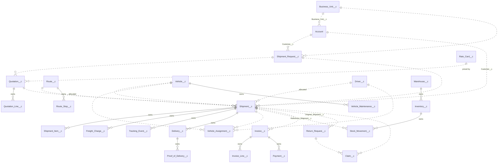

# eLogix ERP - Data Model

Status: **deployed and verified** in `eLogixDev` (Phase 1, 2026-11-19).

This document explains the shape of the model and why it is that way. The field-by-field reference is generated from the model and cannot drift. It is in [generated/DATA_MODEL_CATALOGUE.md](generated/DATA_MODEL_CATALOGUE.md).

Source of truth: `scripts/node/model/elogix-datamodel.mjs` → `npm run metadata:generate` → `force-app/main/default/objects/`.

## 1. Inventory

| Module (CLAUDE.md section 4) | Objects | Org-wide default |
|---|---|---|
| A. Customer | `Account`, `Contact` (+9 custom fields) | Org default |
| B. Business unit | `Business_Unit__c` | Public Read Only |
| C. Request and quotation | `Shipment_Request__c`, `Quotation__c`, `Quotation_Line__c` | Private / Private / Controlled by Parent |
| D. Shipment | `Shipment__c`, `Shipment_Item__c` | Private / Controlled by Parent |
| E. Fleet | `Vehicle__c`, `Driver__c`, `Vehicle_Assignment__c`, `Vehicle_Maintenance__c` | Read / Read / Read-Write / Controlled by Parent |
| F. Warehouse | `Warehouse__c`, `Inventory__c`, `Stock_Movement__c` | Read / Controlled by Parent / Controlled by Parent |
| G. Route and pricing | `Route__c`, `Route_Stop__c`, `Rate_Card__c`, `Freight_Charge__c` | Read / CbP / Read / CbP |
| H. Tracking and delivery | `Tracking_Event__c`, `Delivery__c`, `Proof_of_Delivery__c` | Controlled by Parent |
| I. Finance | `Invoice__c`, `Invoice_Line__c`, `Payment__c` | Private / CbP / CbP |
| J. Reverse logistics | `Return_Request__c`, `Claim__c` | Private |
| Integration (section 11) | `Integration_Log__c` | Public Read/Write (admin-only object permission) |
| Configuration | `Shipment_Status_Transition__mdt`, `eLogix_Setting__mdt` | Custom metadata |

Totals: 26 custom objects, 327 custom fields, 10 global value sets, 2 custom metadata types (53 records), 70 validation rules.

## 2. Entity relationship diagram

Solid lines are master-detail (owned); dashed lines are lookups.

Master-detail chains go at most three levels deep (`Warehouse → Inventory → Stock Movement`, `Shipment → Delivery → Proof of Delivery`). That is within the platform limit.

## 3. Modelling conventions

1. **Business keys.** Transactional records use Auto Number names (`SR-`, `QT-`, `SHP-`, `INV-`, `RET-`, `CLM-` ...). The key fields named in the spec (`Shipment_Number__c`, `Invoice_Number__c`, ...) are formulas equal to `Name`. Master data carries a unique External ID code (`Customer_Code__c`, `Business_Unit_Code__c`, `Vehicle_Number__c`, `License_Number__c`, `Warehouse_Code__c`, `Route_Code__c`, `Rate_Card_Code__c`). Seed scripts upsert on these codes, so they are idempotent and never hardcode IDs.
2. **Idempotency keys.** These unique, externally-written keys stop the same business event being applied twice:

   | Field | Key composition (set by the owning service) | Prevents |
   |---|---|---|
   | `Invoice__c.Invoice_Key__c` | `<Shipment Id>:<Billing Milestone>` | A second invoice for the same shipment and milestone |
   | `Stock_Movement__c.Movement_Key__c` | Caller-supplied transaction id | Double-posting a stock change |
   | `Tracking_Event__c.Event_Key__c` | `<Shipment Id>:<from>:<to>:<timestamp>` or GPS ping id | Duplicate history from retries and GPS replays |
   | `Payment__c.Idempotency_Key__c` | Gateway callback id | Applying a payment callback twice |
   | `Integration_Log__c.Idempotency_Key__c` | Outbound request key | Duplicate callouts on retry |
   | `Inventory__c.Inventory_Key__c` | `<Warehouse Code>:<SKU>` | Two stock records for one SKU in one warehouse |
3. **Derived values are never typed.** Totals are roll-ups and formulas:
   - Quotation: `Subtotal = base + weight + distance + fuel + insurance + additional lines - discount`; `Tax = Subtotal × Tax %`; `Total = Subtotal × (1 + Tax %)`.
   - Invoice: `Subtotal` = Σ line amounts, `Tax` = Σ line tax, `Paid` = Σ **Completed** payments only, `Balance` = `Subtotal + Tax − Paid`.
   - Shipment: `Item_Count__c`, `Total_Item_Weight__c`, `Total_Declared_Value__c`, `Additional_Charges__c`.
   - Inventory: `Net_Available_Quantity__c`, `Is_Below_Reorder__c`, `Stock_Value__c`; Warehouse totals roll up from inventory.
4. **Eligibility flags as formulas.** `Vehicle__c.Is_Allocatable__c` is true when the vehicle is Available and its registration and insurance are valid. `Driver__c.Is_Allocatable__c` is true when the driver is Available and the licence is valid. `Vehicle__c.Open_Maintenance_Count__c` counts maintenance that is neither Completed nor Cancelled. `FleetAllocationService` uses these to pre-filter candidates in SOQL. It still re-checks them under a row lock before allocating, because the formulas use `TODAY()`.
5. **Shared vocabularies** are global value sets. `Vehicle_Type__c` on both Vehicle and Rate Card uses `eLogix_Vehicle_Type`, so a rate card always matches a vehicle type exactly. Every shipment status has a same-named tracking event type, which makes the transition → event mapping 1:1.
6. **Immutable audit objects.** `Tracking_Event__c` and `Stock_Movement__c` cannot be edited after insert (validation rules) and only the Administrator can delete them. Corrections are new records.
7. **Formulas never reference other formula fields**, so deployment order does not matter. Formulas may reference roll-ups.

## 4. Deviations from the specification (CLAUDE.md section 4)

| Spec item | Implementation | Reason |
|---|---|---|
| `Business_Unit__c.CurrencyIsoCode` "where applicable" | Not created | Multi-currency is not enabled in the target org, so the field does not exist. |
| `Quotation__c.Tax_Amount__c`, `Total_Amount__c` as stored fields | Formula fields, plus `Tax_Percent__c` and `Subtotal__c` | Totals cannot disagree with their components. The freight service snapshots the components. |
| `Invoice__c.Subtotal__c`, `Tax__c`, `Paid_Amount__c` | Roll-up summaries; `Total_Amount__c` and `Balance_Amount__c` are formulas | "Invoice total must match its line items" holds by construction. |
| `Rate_Card__c.Rate_Card_Name__c` | Formula = `Name`, plus a unique `Rate_Card_Code__c` | Name stays editable; the code is the idempotent key. |
| Additions not in the spec | `Route__c` lookups on request and shipment, `Inventory__c` / `Warehouse__c` lookups on shipment item, approval stamps, idempotency keys, `Integration_Log__c` | Needed by the services and rules in later phases. Each is documented in the catalogue. |

## 5. Storage budget (5 MB data storage)

| Data set | Records | About 2 KB each |
|---|---|---|
| Master data: 5 business units, 10 customers plus contacts, 10 vehicles, 10 drivers, 5 warehouses, about 40 inventory rows, 10 routes plus stops, 6 rate cards | ~130 | 0.26 MB |
| Transactions: 20 requests, 15 quotations plus lines, 20 shipments plus items and charges, invoices, lines and payments, returns and claims | ~200 | 0.40 MB |
| History: tracking events (~6 per shipment), stock movements, assignments, deliveries | ~250 | 0.50 MB |
| **Total planned demo footprint** | **~580** | **~1.2 MB (24%)** |

Field history rows do not count against data storage. Integration logs are capped by a purge job (Phase 6).
