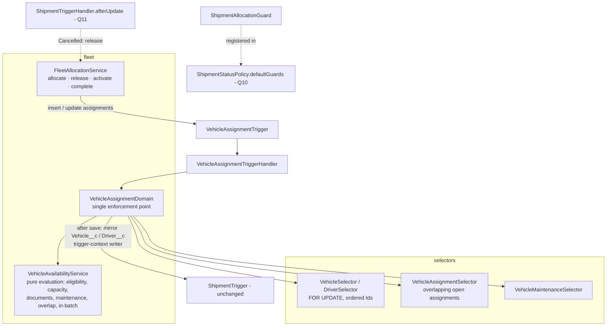

# eLogix ERP - Phase 4 Discovery and Implementation Plan (Fleet Allocation)

| | |
|---|---|
| Status | **Approved 2026-11-20; implemented, check-only verified, not yet deployed or committed.** Decisions and clarifications are in section 0; outcome in [PHASE4_IMPLEMENTATION_REPORT.md](PHASE4_IMPLEMENTATION_REPORT.md). |
| Baseline | Branch `feature/phase-2-apex-foundation`, commit `d205c9d` (Phase 3); org `eLogixDev` at deploy `0Afg700000KRUWMCA5` |
| Discovery | 2026-11-19, read-only: CLAUDE.md, roadmap and architecture docs, model files, deployed metadata, live org |
| Related | [SOLUTION_ARCHITECTURE.md](SOLUTION_ARCHITECTURE.md) · [APEX_ARCHITECTURE.md](APEX_ARCHITECTURE.md) · [APEX_FRAMEWORK.md](APEX_FRAMEWORK.md) · [BUSINESS_RULES.md](BUSINESS_RULES.md) · [SHIPMENT_LIFECYCLE.md](SHIPMENT_LIFECYCLE.md) · [SECURITY_DESIGN.md](SECURITY_DESIGN.md) · [PRICING_IMPLEMENTATION.md](PRICING_IMPLEMENTATION.md) |

Notation:
- **[C]** means confirmed by CLAUDE.md, an approved project document or the deployed metadata.
- **[R]** means my recommendation.
- **[Q]** means a decision needed from you. No [Q] has been resolved by assumption.

## 0. Approved decisions (2026-11-20)

All 18 recommendations were approved, with these clarifications. They override the wording of sections 5 to 14 where the two differ.

| # | Decision as approved | Implemented in |
|---|---|---|
| Q1 | Bookings are time windows. A vehicle or a driver cannot hold two overlapping open assignments, including two in the same bulk transaction. | `VehicleAvailabilityService` (stored and in-batch conflicts) |
| Q2 | Vehicle and driver status is administrative only. Allocation never changes it. `Is_Allocatable__c` formulas updated through the generator. | `elogix-datamodel.mjs` |
| Q3 | Window = pickup date 00:00:00 to expected delivery date 23:59:59, org time zone. Both dates mandatory; end before start rejected. Windows are half-open in comparison, so back-to-back days do not overlap. | `AssignmentWindow` |
| Q4 | Insurance, registration and licence valid through the window end. Fitness checked only when filled in, then also through the window end. **Intentional business rule:** a blank fitness date is treated as "not applicable to this vehicle class". | `VehicleAvailabilityService.documentViolation` |
| Q5 | Allocation is blocked when the vehicle is Under Maintenance or has maintenance In Progress. In Progress maintenance always blocks, whatever its dates, because ongoing work has no known end. Scheduled maintenance blocks when its dates overlap the window: from `Scheduled_Date__c` to `Completion_Date__c`, or **only its scheduled day** when there is no completion date. An overdue Scheduled job that never started does not block later trips; set it In Progress to block. (Wording corrected after the audit; behaviour unchanged.) | `VehicleAvailabilityService` |
| Q6 | Capacity must be at least the shipment weight. No load sharing. | `VehicleAvailabilityService` |
| Q7 | A quoted shipment needs the vehicle type of its quotation's rate card. | `VehicleAvailabilityService` |
| Q8 | Shipment, vehicle and driver in the same business unit. | `VehicleAvailabilityService` |
| Q9 | Initial allocation while Confirmed or On Hold. Reallocation only before Ready for Dispatch. None at or after Ready for Dispatch. One open assignment per shipment. | `VehicleAssignmentDomain` |
| Q10 | One-line change to `ShipmentStatusPolicy.defaultGuards()` adding `ShipmentAllocationGuard`. | `ShipmentStatusPolicy` |
| Q11 | Cancelling a shipment cancels its Planned assignment automatically. Minimal change to `ShipmentTriggerHandler`; no recursion, no duplicate release, historical assignments untouched. | `FleetAllocationService` trigger-only methods |
| Q12 | Assignment statuses Planned, Active, Completed, Cancelled. Phase 4 builds the foundation; Phase 5 wires Active and Completed to dispatch and delivery. | `VehicleAssignmentDomain` |
| Q13 | Fleet Manager gains read-only View All on Shipment. No View All Data, Modify All Data or extra edit permissions. | `elogix-security.mjs` |
| Q14 | The assignment trigger enforces every rule on every path and requires `eLogix_Allocate_Fleet` for user changes. The only exemption is the automatic release during shipment cancellation, recognised from the stored record state, never from a caller flag. | `VehicleAssignmentDomain.isAutomaticRelease` |
| Q15 | Formula expiry indicators (`Document_Status__c`, `License_Status__c`) and list views, warning window in `eLogix_Setting.Document_Expiry_Warning_Days` (30). Covers insurance, registration, fitness and licences. Expired and Expiring Soon stay distinct. No scheduled batch. | Generator model |
| Q16 | A lock wait timeout becomes a retryable per-record `FLEET_BUSY` error. No retry loops. | `VehicleAssignmentDomain`, `FleetAllocationService.codeFor` |
| Q17 | Maintenance created over existing assignments is deferred and documented as a limitation. | [FLEET_IMPLEMENTATION.md](FLEET_IMPLEMENTATION.md) section 8 |
| Q18 | The assignment trigger owns `Shipment__c.Vehicle__c` and `Driver__c`. Planned or Active sets them; Cancelled clears each only while it still references that assignment's vehicle or driver; Completed keeps them. | `VehicleAssignmentDomain.syncShipments` |

Authorised changes to earlier phases: `ShipmentStatusPolicy.defaultGuards()`, the `ShipmentTriggerHandler` cancellation hooks, the allocatable formulas, Fleet Manager Shipment View All, and the Q15 configuration. One Phase 2 test (`ShipmentStatusTransitionConfigTest`) was adjusted because in-memory records cannot satisfy the new guard; it now also asserts the guard is in the default set.

## 1. Objectives

Allocate a vehicle and a driver to a shipment so that the allocation is always safe and correct:
- the vehicle is compliant and has enough capacity;
- the driver is licensed;
- neither is double-booked;
- nothing is under maintenance.

These rules must hold under concurrency and in bulk, whatever the entry path. Phase 4 also closes the Phase 2 lifecycle gap: a shipment must not reach Ready for Dispatch without an allocation.

## 2. Scope from the roadmap

### 2.1 Confirmed scope

| # | Item | Source |
|---|---|---|
| S1 | `FleetAllocationService` and `VehicleAvailabilityService`: capacity, validity, overlap, row locking, tests | PROJECT_STATUS phase plan row 4; CLAUDE.md section 7 (core classes) |
| S2 | Fleet rules: vehicle active; sufficient capacity; driver active; valid licence; valid insurance and registration; no conflicting active assignments for vehicle or driver; vehicles under maintenance cannot be assigned. "Implement appropriate record locking and overlap checks to reduce concurrent allocation conflicts." | CLAUDE.md section 5, Fleet Rules |
| S3 | API: `allocate(List<AllocationRequest>)`, `release(List<Id> assignmentIds)`; permission `eLogix_Allocate_Fleet` | API_SPECIFICATION; SECURITY_DESIGN (Admin, Logistics Manager, Fleet Manager) |
| S4 | Guard for Ready for Dispatch: vehicle and driver allocated (deferred from Phase 2, decision D3) | APEX_ARCHITECTURE section 9; SHIPMENT_LIFECYCLE section 2; transition `Confirmed → Ready for Dispatch` ("Requires vehicle and driver allocation") |
| S5 | `Shipment__c.Vehicle__c` and `Driver__c` are protected fields written only by `FleetAllocationService` | SECURITY_DESIGN protected fields; `elogix-security.mjs` |
| S6 | Tests: vehicle capacity validation, driver licence validation, conflicting fleet assignment, bulk, exception and rollback | CLAUDE.md section 13; FR-06 (P0) in BUSINESS_REQUIREMENTS |
| S7 | Demo step 6: an expired-insurance truck and a double-booked driver are rejected | DEMO_SCRIPT |

### 2.2 Listed for Phase 4 elsewhere, needs your decision

| # | Item | Why it is unclear |
|---|---|---|
| S8 | `DocumentExpiryBatch`: "flags vehicles and drivers whose registration, insurance or licence expires within 30 days" | AUTOMATION_DESIGN section 3 assigns it to P4, but no flag field exists, the threshold is not configured, and CLAUDE.md asks to avoid unnecessary asynchronous processing. See Q15. |

### 2.3 Out of scope (confirmed by the roadmap)

| Item | Phase |
|---|---|
| `fleetManagement` and `vehicleAllocation` LWCs and their `@AuraEnabled` controllers | P7 |
| Dispatch, delivery and inventory (`DeliveryService`, `InventoryService`); Flows | P5 |
| GPS and vehicle telematics | P6 |
| Roles and sharing rules | P9 |
| Fleet utilisation reports | P8 |

## 3. Repository and org findings

| # | Finding | Consequence |
|---|---|---|
| F1 | The org has 0 vehicles, drivers, assignments, maintenance records and shipments. Triggers: `ShipmentTrigger`, `QuotationTrigger`. No active Flows. Salesforce Platform licences: 0 of 6 used. Storage: 5 MB free. | Greenfield for fleet; test users fit the licences. |
| F2 | `Vehicle_Assignment__c`: `Vehicle__c`, `Driver__c` (required), `Shipment__c` and `Business_Unit__c` (optional lookups), `Assignment_Start__c` (required datetime), `Assignment_End__c` (optional), `Status__c` = Planned (default) / Active / Completed / Cancelled, formula `Is_Open__c` (Planned or Active). OWD **Public Read/Write**. No trigger, **no protected fields**. | Fleet Manager (CREDV) and Logistics Manager (CREV) can create and edit assignments directly. **The rules must be enforced in a trigger domain**, as Phase 3 does for quotations; a service alone can be bypassed. |
| F3 | `Vehicle__c.Status__c` = Available / Assigned / In Transit / Under Maintenance / Inactive. `Is_Allocatable__c` requires **Status = Available** plus registration and insurance valid **today**. `Is_Documents_Valid__c` checks registration and insurance; `Fitness_Expiry__c` exists but is not included. | The formula describes an "available right now" model, not booking in time windows. See Q1, Q2 and Q4. |
| F4 | `Driver__c.Status__c` = Available / On Duty / On Leave / Inactive. `Is_Allocatable__c` requires Available plus licence valid today. `License_Expiry__c` is required. | Same question as F3. |
| F5 | `Vehicle__c.Open_Maintenance_Count__c` counts maintenance records not Completed or Cancelled, **including future scheduled work**. Maintenance has only `Scheduled_Date__c` and `Completion_Date__c`, with no planned duration. | A rule of "any open maintenance blocks the vehicle" would block it for weeks ahead. See Q5. |
| F6 | Validation rules: `VA_End_After_Start`, `VA_End_Required_When_Completed`, `VEH_Capacity_Positive`, `VEH_Odometer_Non_Negative`, `VM_*` (3). None for driver documents. | Phase 4 does not duplicate them. |
| F7 | Access: Fleet Manager has Vehicle, Driver, Assignment and Maintenance CREDV but **Shipment R without View All**. Logistics Manager has Shipment CREV (View All, not Modify All). Operations has fleet objects read-only. Shipments are **Private**. | **The Fleet Manager cannot see any shipment owned by someone else** until Phase 9 sharing, so cannot allocate it. See Q13. |
| F8 | `Shipment__c.Vehicle__c` and `Driver__c` are protected (read-only FLS for every role except Administrator). | The allocation must write them in system mode after its checks, through a narrow writer, following the Phase 2 and 3 patterns. |
| F9 | The Phase 2 guard extension point is `ShipmentStatusPolicy.defaultGuards()`, which currently returns only `ShipmentItemsRequiredGuard`. | Adding the allocation guard needs **a one-line change to a Phase 2 production class**, the designed extension point. See Q10. |
| F10 | Reacting to shipment status changes (cancellation, dispatch, delivery) needs `ShipmentTriggerHandler` (Phase 2) to call into fleet, because only one trigger is allowed per object. | Automatic release or completion of assignments is a Phase 2 touch. See Q11 and Q12. |
| F11 | Shipment dates are `Date` fields (`Pickup_Date__c`, `Expected_Delivery_Date__c`, both optional); assignment times are `Datetime`. The org time zone is Asia/Kolkata. | The assignment window must be derived by a defined rule. See Q3. |
| F12 | The quotation's `Rate_Card__c.Vehicle_Type__c` is what the customer was priced for. The shipment has no vehicle-type field. | Allocating a different vehicle type would break the quoted price. See Q7. |

## 4. Reuse and conflicts

| Reuse (no change) | How |
|---|---|
| `TriggerHandler`, `ServiceResult`, exceptions, `Logger`, `ExceptionHandler`, `PermissionService`, `SettingsService` | Same framework, conventions and labels approach |
| `ShipmentStatusGuard` interface | New `ShipmentAllocationGuard` (0 SOQL; reads `Vehicle__c` and `Driver__c` on the trigger record) |
| `ShipmentTrigger` and `TrackingService` | Shipment updates by the allocation writer change no status, so they cost nothing (verified pattern from Phase 2 and 3) |
| Phase 3 patterns | Trigger-side domain as the single enforcement point; the trigger-context-only writer (F1 pattern); per-record compensation; two-layer security tests |
| `TestDataFactory` | Extended with vehicle, driver, assignment and maintenance builders |

Conflicts to avoid:
- Exactly one new trigger on `Vehicle_Assignment__c`; no Flows on fleet objects.
- The eligibility and overlap logic lives once, in `VehicleAvailabilityService`. Both the service pre-checks and the trigger domain call it; the logic is never copied.
- The existing `Is_Allocatable__c` formulas are not used for enforcement if they disagree with the decisions on Q1, Q2 and Q4. Either they are updated through the generator, or they stay as list-view helpers only. See Q2.

## 5. Decisions needed

| # | Question | Options | **[R]** Recommendation |
|---|---|---|---|
| **Q1** | **Availability model** | (a) **Time-window**: a vehicle or driver may hold several assignments whose windows do not overlap; conflicts are checked on open (Planned or Active) assignments. (b) **Status-exclusive**: one open assignment at a time; the vehicle becomes Assigned and cannot be booked again until released. | **(a).** It matches "overlap checks" in CLAUDE.md and real fleet planning (book tomorrow's trip while today's is running). |
| **Q2** | **Use of `Vehicle__c.Status__c` and `Driver__c.Status__c`** | (a) Allocation does **not** change them. Status is administrative: vehicle Available / Under Maintenance / Inactive, driver Available / On Leave / Inactive. Assigned, In Transit and On Duty stay unused until P5 dispatch decides. Eligibility = vehicle not Under Maintenance or Inactive; driver not On Leave or Inactive. The `Is_Allocatable__c` formulas are updated to match through the generator (a Phase 1 model change). (b) Allocation sets Assigned and On Duty (only consistent with Q1 (b)). | **(a)**, including the formula update so list views and reports agree with the service. |
| **Q3** | **Assignment window** | (a) Derived from the shipment: start = `Pickup_Date__c` 00:00, end = `Expected_Delivery_Date__c` 23:59:59 (org time zone); both dates required, otherwise the allocation fails. (b) The caller supplies start and end. (c) (a) with an optional caller override. | **(a)**: one source of truth; no open-ended assignments. |
| **Q4** | **Document validity** | Registration and insurance (vehicle) and licence (driver) must be valid (a) today only, or (b) **through the end of the assignment window**. Include `Fitness_Expiry__c`? | **(b)**. Fitness: include only when filled in (blank means not tracked), because CLAUDE.md names only insurance and registration. Your call on fitness. |
| **Q5** | **Maintenance** | (a) Any open maintenance blocks (the current roll-up). (b) A vehicle is blocked when its Status is Under Maintenance, or it has In Progress maintenance, or Scheduled maintenance whose `Scheduled_Date__c` falls inside the window. | **(b)**. Scheduled maintenance occupies its scheduled day. |
| **Q6** | **Capacity and consolidation** | Vehicle `Capacity__c` ≥ `Shipment__c.Weight__c`; one shipment per vehicle per window (no load consolidation). | Adopt. Consolidation is a later feature. |
| **Q7** | **Vehicle type** | When the shipment came from a quotation, the vehicle type must equal the rate card's `Vehicle_Type__c` (pricing integrity). Otherwise any type with enough capacity. | Adopt. |
| **Q8** | **Business unit** | Vehicle and driver must belong to the shipment's business unit. | Adopt. The assignment's `Business_Unit__c` is set from the shipment. |
| **Q9** | **When allocation is allowed** | Allocate when the shipment is Confirmed or On Hold. Reallocate (release, then allocate) while Confirmed, Ready for Dispatch or On Hold. Never after Dispatched. At most **one open assignment per shipment**. | Adopt. |
| **Q10** | **Ready for Dispatch guard** (S4) | Register `ShipmentAllocationGuard` (target Ready for Dispatch: `Vehicle__c` and `Driver__c` set) through the **one-line change** in `ShipmentStatusPolicy.defaultGuards()`, a Phase 2 production class. | **Approve the one-line change.** It is the designed extension point. Like the item guard, it also applies under the status override. |
| **Q11** | **Shipment cancelled or moved back** | When a shipment with an open assignment is Cancelled, should the assignment be cancelled automatically? This needs a small addition to `ShipmentTriggerHandler.afterUpdate` (Phase 2). The alternative is a manual `release`, with orphaned Planned assignments blocking vehicles until then. | **Automatic cancel-release in Phase 4** (one call from `ShipmentTriggerHandler.afterUpdate`), because orphans make vehicles look booked. |
| **Q12** | **Assignment lifecycle after allocation** | Planned → Active on Dispatched, Active → Completed on Delivered, recording the actual end. Wire it now (also through `ShipmentTriggerHandler`), or in Phase 5 with `DeliveryService`? | **Phase 4 defines the transitions** in the assignment domain (Planned → Active / Cancelled; Active → Completed; Completed and Cancelled terminal) **and exposes service methods; the wiring to shipment Dispatched and Delivered waits for P5.** |
| **Q13** | **Fleet Manager cannot see shipments** (F7) | (a) Grant Fleet Manager **View All on `Shipment__c`** (read only) through the permission-set model, a Phase 1 change. (b) Wait for Phase 9 sharing; in Phase 4 only the Logistics Manager and Admin can allocate. | **(a).** Least-privilege read access is needed to plan the fleet; no edit access is granted. |
| **Q14** | **Direct DML on assignments** | Enforce in the trigger: insert and update need `eLogix_Allocate_Fleet`; all eligibility, capacity, document, maintenance, overlap, business-unit and type rules; allowed status transitions; window and vehicle/driver/shipment immutable once Active. | Adopt. |
| **Q15** | **Document expiry "flags"** (S8) | (a) Defer to P5/P8 (reports and list views). (b) A scheduled batch creating Tasks. (c) A formula `Documents_Expiring_Soon__c` on vehicle and driver plus list views; threshold days as a new `eLogix_Setting__mdt` record (Phase 1 change; formulas can read custom metadata). | **(c)**, with **no batch**: CLAUDE.md asks to avoid unnecessary asynchronous work, and a formula is always current. |
| **Q16** | **Lock contention** | When `FOR UPDATE` times out (`UNABLE_TO_LOCK_ROW`) under concurrent allocation: return a per-record, retryable `FLEET_BUSY` error instead of an exception. | Adopt (learned from Phase 2 F5). |
| **Q17** | **Maintenance booked over an existing assignment** | Block creating or scheduling maintenance inside an open assignment window (needs a `Vehicle_Maintenance__c` trigger)? | **Defer, and document.** Phase 4 enforces allocation-side rules only. |
| **Q18** | **Shipment mirror fields** | `Shipment__c.Vehicle__c` and `Driver__c` are set while an open assignment exists, cleared when it is Cancelled, and kept when it is Completed (history). They are maintained by the **assignment trigger**, so any entry path keeps them consistent. | Adopt. |

## 6. Proposed architecture

| Component | Folder | Sharing | Responsibility |
|---|---|---|---|
| `AllocationRequest` | fleet | inherited | DTO: `shipmentId`, `vehicleId`, `driverId`, `remarks` |
| `FleetAllocationService` | fleet | with | Use cases (section 6.2): access checks, request validation, insert or update of assignments, per-record `ServiceResult`, lock-timeout mapping (Q16) |
| `VehicleAvailabilityService` | fleet | with | **Pure** evaluation of a batch of candidate assignments against loaded vehicles, drivers, shipments, open assignments and maintenance. Returns violations keyed by index. No SOQL or DML of its own, so every rule can be unit-tested exhaustively. |
| `VehicleAssignmentDomain` | fleet | with | Before insert/update: permission (Q14), status transitions, immutability, locks plus `VehicleAvailabilityService` for every new or changed open assignment. After save: the shipment mirror (Q18) through a private `without sharing` writer that reads the trigger context itself. |
| `VehicleAssignmentTriggerHandler`, `VehicleAssignmentTrigger` | handlers, triggers | with | Routing only |
| `ShipmentAllocationGuard` | shipment | with | Implements `ShipmentStatusGuard`; target Ready for Dispatch; 0 SOQL |
| `VehicleSelector`, `DriverSelector`, `VehicleAssignmentSelector`, `VehicleMaintenanceSelector` | selectors | inherited | Locks (`FOR UPDATE`, Ids sorted to avoid deadlocks); overlap query (system mode, Ids and windows only, so conflicts are detected whatever the caller's sharing) |

### 6.1 Single enforcement point

Every rule in Q1 to Q9 and Q14 is checked in `VehicleAssignmentDomain` (before insert or update) by calling `VehicleAvailabilityService`, so UI, API, Data Loader, Flows and the service are all covered. `FleetAllocationService` only adds orchestration and friendly per-record errors; it does not re-implement rules.

### 6.2 Data flow: `allocate(List<AllocationRequest>)`

1. **Access.** The user needs `eLogix_Allocate_Fleet` and create access on `Vehicle_Assignment__c`. Shipments, vehicles and drivers are read in user mode; a record the user cannot see gets `NOT_FOUND`.
2. **Shipment state (Q9).** Status Confirmed or On Hold; no open assignment already; window derived (Q3); both dates present.
3. **Insert** Planned assignments with partial success.
4. **Trigger, before insert.**
   - Lock the vehicles and drivers (`FOR UPDATE`, sorted Ids).
   - Load overlapping open assignments, maintenance on those vehicles, and the shipments' weight, business unit and quoted vehicle type.
   - Evaluate the whole batch, including conflicts between requests in the same batch.
   - Add errors per row.
5. **Trigger, after insert.** Mirror `Vehicle__c` and `Driver__c` onto the shipments (Q18). A shipment that cannot be updated fails only its own assignment row.
6. **Result:** per-record `ServiceResult`.

**Expected cost for 200 allocations:** about 6 SOQL (shipments, vehicles, drivers, open assignments, maintenance, quotation vehicle types) and 2 DML (assignment insert, shipment mirror update). `ShipmentTrigger` costs nothing, because no status changes.

**`release(List<Id>)`:** Planned → Cancelled (Active cannot be released, only completed). The mirror is cleared in the same transaction. Not allowed once the shipment is Dispatched or later.

### 6.3 Assignment lifecycle (Q12, Q14)

| From | Allowed to | By |
|---|---|---|
| (new) | Planned | `allocate`, or direct DML that passes every rule |
| Planned | Active, Cancelled | `activate` (P5 dispatch wiring), `release`, shipment cancellation (Q11) |
| Active | Completed (actual end recorded) | `complete` (P5 delivery wiring) |
| Completed, Cancelled | none (terminal) | n/a |

The vehicle, driver, shipment and window cannot change once Active. While Planned, changing them re-runs every rule.

## 7. Security design

| Concern | Design |
|---|---|
| Permission | `eLogix_Allocate_Fleet` is required in the service **and** in the trigger for assignment insert and update (Q14). Today it is held by Admin, Logistics Manager and Fleet Manager. |
| Record access | Shipments, vehicles and drivers are read in user mode before allocating; Q13 decides Fleet Manager shipment visibility. |
| Protected fields | `Shipment__c.Vehicle__c` and `Driver__c` are written only by the assignment trigger's private writer, in system mode. It reads `Trigger.new` and `Trigger.oldMap` itself and refuses other callers (the Phase 2 F1 pattern), so no caller can point a shipment at an unvetted vehicle. |
| Conflict detection | The overlap query runs in system mode (returns Ids and windows only), so a conflict can never be hidden by the caller's sharing. Assignments are Public Read/Write anyway. |
| Sharing | No new `without sharing` class other than the private mirror writer. Everything else is `with sharing` or `inherited sharing`. |
| Two-layer tests | As in Phase 3: a user without the permission is refused, and an administrator who does have access is still stopped by the trigger rules. |
| External surface | None added (no `@AuraEnabled`, REST, invocable or `global`); the P7 LWCs add their own controllers. |

## 8. Bulkification, concurrency and error handling

- All checks are batch-wide: one query per data set, maps keyed by Id, and in-memory overlap detection for requests in the same batch.
- Locks are taken in a fixed order (vehicles, then drivers, each sorted by Id) to avoid deadlocks between concurrent allocations. Shipment then assignment row order matches Phase 3 (parent first).
- Partial success everywhere. A failed shipment-mirror update fails only its own assignment row (`addError`), so there is no batch-wide rollback (Phase 2 F5 lesson).
- Lock timeouts become retryable per-record `FLEET_BUSY` results (Q16), not unhandled exceptions.
- Logging: Ids, codes and counts only.

## 9. Data model and metadata changes (only those your decisions require)

| Change | Needed for | Through |
|---|---|---|
| `Vehicle__c.Is_Allocatable__c` and `Driver__c.Is_Allocatable__c` aligned with Q2 (status no longer has to be Available; the time-window check stays in Apex) | Q2 (a) | Generator (`elogix-datamodel.mjs`) |
| Fleet Manager: View All (read) on `Shipment__c` | Q13 (a) | Generator (`elogix-security.mjs`) |
| `Documents_Expiring_Soon__c` formulas on vehicle and driver; setting `Document_Expiry_Warning_Days` (30); list views | Q15 (c) | Generator (`elogix-datamodel.mjs`, `elogix-config.mjs`, `elogix-experience.mjs`) |
| About 15 custom labels | All | Hand-maintained labels file |
| New trigger `VehicleAssignmentTrigger` | S2 | Source |
| `ShipmentStatusPolicy.defaultGuards()` +1 line; `ShipmentTriggerHandler.afterUpdate` +1 call | Q10, Q11 | **Phase 2 production code. Only with your approval.** |

Model changes are deployed first and separately (validator, check-only, deploy, Phase 1 to 3 scripts), as in Phase 3.

## 10. Test plan

| Class | Scenarios |
|---|---|
| `VehicleAvailabilityServiceTest` (pure) | Each rule alone and combined: inactive or under-maintenance vehicle; driver on leave; capacity at, below and above weight; registration, insurance and licence valid up to the window end, expiring inside it, or blank; fitness rule (Q4); maintenance In Progress, Scheduled inside the window, or outside it (Q5); overlap with Planned and Active assignments, touching boundaries (end = next start), Completed and Cancelled ignored; business-unit mismatch; vehicle-type mismatch with a quotation, any type without one; in-batch double-booking of a vehicle and of a driver |
| `FleetAllocationServiceTest` | Allocate success (assignment Planned, window derived, mirror set); shipment status gates (Q9); one open assignment per shipment; release (cancels and clears the mirror); permission denied (Operations); invisible shipment; **bulk 200** (SOQL and DML counted); per-record failures; lock-timeout mapping (simulated through an injected selector seam, no production switch) |
| `VehicleAssignmentTriggerHandlerTest` | Direct DML as Fleet Manager and as an administrator: every rule enforced without the service; status transitions and terminal states; immutability once Active; permission check; mirror sync on direct insert, update and cancel; trigger-context writer refuses outside callers; a 200-row save with no relevant change costs 0 SOQL |
| `ShipmentAllocationGuardTest` and policy integration | Confirmed → Ready for Dispatch refused without an allocation and allowed with one; On Hold → Ready for Dispatch; applies under override; all Phase 2 and 3 tests unchanged |
| `ShipmentCancellationReleaseTest` (Q11) | Cancelling a shipment cancels its Planned assignment and frees the vehicle for another allocation |
| Regression | All 136 existing tests; Phase 1, 2 and 3 verification scripts |

New rolled-back script `scripts/apex/verify-phase4-fleet.apex`: compliant allocation; expired-insurance truck rejected; double-booked driver rejected; maintenance conflict; capacity; Ready for Dispatch guard; release frees the vehicle; no rows left behind.

## 11. Acceptance criteria

1. Every Fleet rule in CLAUDE.md section 5 is enforced on every entry path, with labelled per-record errors.
2. No vehicle or driver can hold overlapping open assignments, including within one batch. Locks serialise concurrent allocations.
3. Documents valid through the window (Q4); maintenance per Q5; capacity, business unit and type per Q6 to Q8.
4. A shipment cannot enter Ready for Dispatch without an allocation (Q10); cancelling a shipment frees its fleet (Q11).
5. `Shipment__c.Vehicle__c` and `Driver__c` always reflect the open assignment and cannot be set by users.
6. Bulk 200 within the stated query budget; no SOQL or DML in loops; partial success without batch-wide rollback.
7. All tests pass; new classes at least 85% covered; Phase 1 to 4 scripts pass; the org matches the repository.
8. No Phase 2 or 3 production change beyond the approved lines (Q10, Q11).

## 12. Deployment and rollback

| Step | Detail |
|---|---|
| 1 | Approved model changes (section 9) through the generator: `metadata:validate`, check-only (`RunLocalTests`), deploy, then the Phase 1 to 3 scripts |
| 2 | Apex: `git diff --check`, validator, check-only (`RunLocalTests`), fix, **one** deploy, then the Phase 1 to 4 scripts and an org-vs-repository comparison |
| 3 | Docs and `PROJECT_STATUS.md`; report; commit only after your approval |

**Rollback.**
- Phase 4 adds new classes, a trigger, labels and additive metadata. There is no fleet data yet.
- To roll back: redeploy the Phase 3 commit `d205c9d`, then deploy a destructive manifest for the new trigger and classes. The trigger goes first, because removing classes that a live trigger references fails.
- If Q10 or Q11 are applied, redeploying Phase 3 restores the one-line Phase 2 changes.
- Model changes are additive (formulas, a View All flag, a setting) and can be reverted through the generator.
- Before Phase 9 seeds data, rollback carries no data risk.

## 13. Risks and dependencies

| Risk | Mitigation |
|---|---|
| Unanswered Q1 to Q5 change the core algorithm | No rule code is written until they are answered |
| Phase 2 code touch (Q10, Q11) | Two single-line extension points, covered by the existing Phase 2 tests plus new ones |
| Lock contention or deadlock under concurrent allocation | Fixed lock order; per-record `FLEET_BUSY`; true concurrency cannot be reproduced in Apex tests (documented, as in Phase 3) |
| Formula fields that depend on `TODAY()` change daily | Enforcement uses explicit date comparisons against the window in Apex, never `TODAY()`-based formulas |
| Fleet Manager visibility (F7) | Q13 |
| Region default and Private OWD (Phase 3 limitations) | Allocation does not use rate-card region; shipment visibility per Q13 |
| 5 MB storage | Tests are rolled back; demo fleet is about 10 vehicles, 10 drivers and 20 assignments (Phase 9) |

### Phase 3 limitations Phase 4 respects

- **A5:** a customer-rejected quotation leaves its request at Quoted. Not touched.
- **Narrow `without sharing` writers:** Phase 4 adds only the trigger-context mirror writer, built on the same guarded pattern.
- **Conversion:** limited to the Logistics Manager or Admin, so shipments to allocate come from them or from Operations.
- **Shipment lifecycle:** starts at Quoted, then Confirmed with items. Allocation begins at Confirmed (Q9).

## 14. Implementation sequence (after approval)

1. Record your decisions in this document (section 5).
2. Model changes approved under Q2, Q13 and Q15: generator, validator, separate check-only and deploy, Phase 1 to 3 scripts.
3. `VehicleAvailabilityService` with exhaustive pure tests.
4. Selectors, `TestDataFactory` builders, `VehicleAssignmentDomain`, handler and trigger, with direct-DML tests.
5. `FleetAllocationService` (allocate, release, activate, complete), with service and bulk tests.
6. `ShipmentAllocationGuard` and the approved Phase 2 lines (Q10, Q11), with integration tests.
7. Labels; `verify-phase4-fleet.apex`.
8. Check-only, then one deploy, then all four scripts, then org-vs-repository parity.
9. Docs (`FLEET_IMPLEMENTATION.md`, `PHASE4_IMPLEMENTATION_REPORT.md`, updates) and `PROJECT_STATUS.md`; then wait for commit approval.
