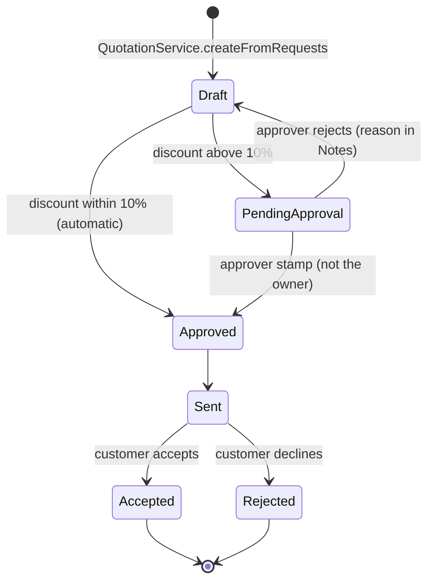

# eLogix ERP - Pricing and Quotation Implementation

| | |
|---|---|
| Status | Live since Phase 3: model change deploy `0Afg700000KOim0CAD`, Apex deploy `0Afg700000KRoekCAD`, follow-up A1 to A3 deploy `0Afg700000KRt9mCAD`, A4 deploy `0Afg700000KRUWMCA5` (2026-11-19) |
| Decisions | [PHASE3_PLAN.md](PHASE3_PLAN.md) section 0 (Q1 to Q22) |
| Source | `classes/pricing/` (`FreightCalculationService`, `FreightRequest`, `FreightBreakdown`); `classes/crm/` (`QuotationService`, `QuotationDomain`); `classes/handlers/QuotationTriggerHandler`; `triggers/QuotationTrigger`; `classes/selectors/` (`RateCardSelector`, `ShipmentRequestSelector`, `QuotationSelector`) |

## 1. Freight calculation

`FreightCalculationService` is the only place pricing arithmetic happens. Every rate, percentage, tax rate and threshold comes from data:

| Value | Source |
|---|---|
| Rates and percentages | `Rate_Card__c` |
| Tax rate | `eLogix_Setting__mdt.Default_Tax_Percent` (12) |
| Validity | `Quotation_Validity_Days` (15) |
| Approval threshold | `Max_Discount_Percent_No_Approval` (10) |

Percent values are Apex values (12 means 12%) and are divided by 100 exactly once, inside the service.

| Component | Rule | Decision |
|---|---|---|
| Weight charge | weight (kg) × `Rate_Per_KG__c` | S1 |
| Distance charge | `Route__c.Distance__c` × `Rate_Per_KM__c` | Q8 |
| Minimum freight | Line haul = base + weight + distance. If it is below `Minimum_Freight__c`, the shortfall is added to `Base_Freight__c`. | Q7 |
| Fuel surcharge | `Fuel_Surcharge_Percent__c` of the line haul after the uplift | Q5 |
| Insurance | `Insurance_Percent__c` of the request's `Declared_Value__c`; blank means 0 | Q6 |
| Rounding | Each component rounded to 2 decimals, HALF_UP, before saving | Q15 |
| Tax | Default setting only; no overrides | Q16 |

### Reference lane (used by tests and the verification script)

Chennai to Bangalore, 350 km, 500 kg, declared value 200,000. LCV card: base 2,000; 3.50/kg; 12.00/km; fuel 10%; insurance 0.5%.

| Component | Amount |
|---|---|
| Base freight | 2,000.00 |
| Weight charge | 1,750.00 |
| Distance charge | 4,200.00 |
| Fuel surcharge (10% of 7,950) | 795.00 |
| Insurance (0.5% of 200,000) | 1,000.00 |
| **Freight charges** | **9,745.00** |
| Tax 12% | 1,169.40 |
| **Total** | **10,914.40** |

### Rate card selection

1. **Candidates.** One user-mode query per batch fetches active cards for the batch's vehicle types that overlap the batch's pricing dates.
2. **Eligibility, per request.** A card is eligible when:
   - its vehicle type matches;
   - it is effective on the request's `Requested_Pickup_Date__c`, with both ends inclusive (Q9);
   - its business unit is blank or equals the request's;
   - its region is blank or equals the business unit's region.
3. **Ranking (Q10).**
   - Specificity first: business unit match = 2, region match = 1.
   - Then the lowest `Selection_Priority__c`; a blank priority ranks last.
   - Then the latest `Effective_From__c`.
4. **Failures.** An exact tie at the top fails as `RATE_CARD_AMBIGUOUS`. No eligible card fails as `RATE_CARD_NOT_FOUND`. Both carry labelled messages.

> **Configuration note.** `Rate_Card__c.Region__c` uses the `eLogix_Region` value set, whose default is **South**. A card saved without clearing the region is therefore South-specific, not generic. The live verification script confirms this (`rate card region after insert without a region = South`). Clear the region when you mean a generic card. Removing the default is a Phase 1 model change; it is listed as an open item.

## 2. Quotation totals (decision Q14)

The deployed formulas, after the Phase 3 model change:

```
Subtotal = charges + Line_Total__c - Discount__c
Tax      = MAX(0, charges + Taxable_Line_Total__c - Discount__c) x Tax_Percent__c
Total    = Subtotal + MAX(0, charges + Taxable_Line_Total__c - Discount__c) x Tax_Percent__c
```

- `charges` = base + weight + distance + fuel + insurance.
- `Taxable_Line_Total__c` is a new roll-up: the sum of lines whose `Is_Taxable__c` is true.
- The header discount reduces the tax base, and tax is never negative.

`FreightCalculationService.quotationTotals()` mirrors these formulas for display and for tests. Two checks assert that they agree to the paisa: the test `totalsMirrorHonoursTaxableLinesAndNeverTaxesBelowZero`, and the live script check "Apex mirror equals formulas".

## 3. Quotation lifecycle (decisions Q2, Q18, Q19, Q22)



`QuotationDomain` (trigger) enforces the following on every entry path:

| Rule | Detail |
|---|---|
| Creation | Status Draft, no approval stamp, rate card present, otherwise `Not_Priced`. The request must be `Submitted` or `Under Review` (Q21); it then moves to `Quoted` (Q4). |
| Request link (A1) | `Shipment_Request__c` never changes after creation, in any status, for any user. A quotation is priced for one request. |
| Transitions | Only those in the diagram. `Accepted` and `Rejected` are terminal; `Expired` and `Superseded` cannot be set (expiry stays with `Is_Expired__c` and `QT_Cannot_Accept_Expired`; revisions are deferred, Q3). |
| Lock (Q18) | After Draft, these cannot change: `Discount__c`, every price component, `Rate_Card__c`, `Tax_Percent__c`, `Shipment_Request__c`, and the line roll-ups, and (A4) `Valid_Until__c`. Line insert and update are also blocked by the validation rule `QTL_Locked_Unless_Draft`. A line delete changes the roll-up, which saves the quotation again, where the lock rejects it. |
| Approval stamp | `Approved_By__c` and `Approval_Date__c` change only on Pending Approval → Approved. The stamp must name the running user, who must hold `eLogix_Approve_Quotation` and must not own the quotation, neither before nor after this save, so an owner change in the same save cannot hide a self-approval (Q17, A2). The approval date is overwritten with the current time. Any other set, change or clear of the stamp is rejected. |
| Threshold | Above `Max_Discount_Percent_No_Approval` (of gross freight, with header discount plus discount lines; Q12, Q13), a quotation can enter Approved, Sent or Accepted only with a valid stamp. |
| Acceptance | Into `Accepted`, the request must be `Quoted`; it moves to `Approved` (Q4). |
| Customer rejection (A5, known limitation) | When the customer rejects a quotation (Sent → Rejected), its shipment request stays at `Quoted`. Re-quoting is deferred (decisions Q3, Q21), so that request has no further path in Phase 3. This is accepted as a known limitation, to be addressed when quotation revisions are implemented. No revision logic and no request-status change were added. |
| Rejection | Pending Approval → Draft is for approvers only (Q22). |

Two layers protect the protected fields. In this org, field-level security stops non-administrator roles from writing price components or the stamp even through DML. The trigger also blocks an administrator-level user who does have field access. Both layers are tested in `QuotationTriggerHandlerTest`.

## 4. `QuotationService` operations

| Operation | Access check | Writes | Cost (200 records) |
|---|---|---|---|
| `createFromRequests(List<Id>)` | Quotation create (describe); requests read in user mode | Quotations in system mode (protected components) | 3 SOQL, 2 DML |
| `recalculate(List<Id>)` | Quotation edit; Draft only | Components in system mode, with sharing | 2 SOQL, 1 DML |
| `submitForApproval(List<Id>)` | Quotation edit; Draft only | Status, user mode | 2 SOQL + trigger |
| `approve(List<Id>)` / `reject(List<Id>, reason)` | `eLogix_Approve_Quotation`; user-mode read; Pending Approval; not the owner (approve) | Stamp or Draft with a note, through `Writer` | 1 SOQL + trigger |
| `convertToShipment(List<Id>)` | Shipment create; user-mode read with row lock; Accepted and unexpired; no existing shipment; request row locked and its status re-read under the lock, so it must still be Approved (A3) | Shipment (status `Quoted`, `Freight_Amount__c` = total) in system mode; request → Converted through `Writer` | 4 SOQL, 3 DML (measured) |

**Per-record failures.** Every operation reports per record (`ServiceResult`).
- Request status moves in the trigger fail only their own quotation row (`addError`).
- In conversion, a shipment whose request cannot move to Converted is deleted again in the same transaction, and only that record is reported (`aFailedRequestUpdateRemovesOnlyItsOwnShipment`).

**Shipment lane on conversion.** Origin, destination and distance come from the route that priced the quotation; weight and dates come from the request. The Phase 2 `ShipmentTrigger` applies the lifecycle policy (initial status `Quoted`) and writes the `Created` tracking event, unchanged.

## 5. Access model and the narrow `without sharing` writers

| Class | Why | What limits it |
|---|---|---|
| `QuotationDomain.RequestStatusWriter` | A Logistics Manager has View All but not Modify All on Sales-owned requests until Phase 9 roles exist. | Writes `Shipment_Request__c.Status__c` only, for the requests of quotations in the current trigger. The calling method reads `Trigger.new` and `Trigger.oldMap` itself and refuses to run elsewhere (`REQUEST_SYNC_TRIGGER_ONLY`). |
| `QuotationService.Writer` | Same reason, for approve and reject on Sales-owned quotations, and for the request status and compensation on conversion. | Private, called only after the explicit checks in section 4. The stamp is re-verified by the trigger. |
| `QuotationSelector.sumDiscountLines` / `selectConvertedQuotationIds` | `WITH SYSTEM_MODE` reads (sharing still applies) for enforcement checks. | Return aggregates or Ids only. |

All other Phase 3 classes are `with sharing` or `inherited sharing`, and read in user mode. No `@AuraEnabled`, REST, invocable or `global` entry points were added; the Phase 5 Flow and Phase 7 LWC will add them with their consumers.
