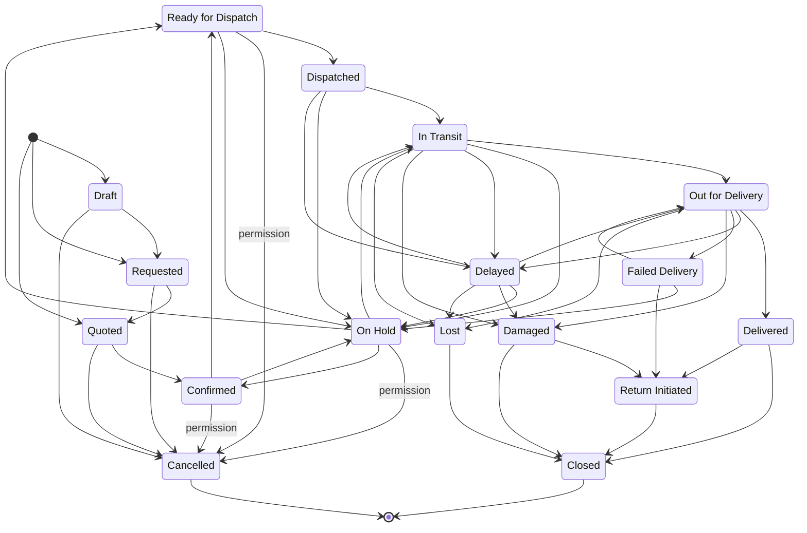

# eLogix ERP - Shipment Lifecycle

| | |
|---|---|
| Configuration | `Shipment_Status_Transition__mdt`: 46 records, **live** in `eLogixDev` |
| Enforcement | `ShipmentStatusPolicy`, **live since Phase 2** (deploy `0Afg700000KNnfeCAD`). `ShipmentTrigger` calls it in before insert and before update for every entry path: UI, API, Flow and services. See [SHIPMENT_POLICY_IMPLEMENTATION.md](SHIPMENT_POLICY_IMPLEMENTATION.md). |
| Status vocabulary | Global value set `eLogix_Shipment_Status` (17 values; default `Draft`) |
| History | Every allowed transition writes one `Tracking_Event__c` (`TrackingService`, live). `Status__c` also has field history tracking. See [TRACKING_IMPLEMENTATION.md](TRACKING_IMPLEMENTATION.md). |

## 1. State diagram

"permission" means the transition needs custom permission `eLogix_Cancel_Confirmed_Shipment`.

## 2. Design rules

1. **Initial statuses.** A shipment can be created only as `Draft`, `Requested` or `Quoted` (records with blank `From_Status__c`). Shipments are never created already `Confirmed`. Their items are child records inserted after the parent, so the at-least-one-item rule can only be checked on the move to `Confirmed`.
2. **Terminal statuses.** `Closed` and `Cancelled` have no outgoing transitions. The generator fails the build if one is added, `ShipmentStatusTransitionConfigTest` fails the deploy, and the policy rejects leaving them even if a row exists (hard rule). This implements "cancelled shipments cannot be processed further".
3. **No re-dispatch.** No path from `Delivered` leads back to `Dispatched` or any earlier status (generator check, deploy-time test and policy hard rule). This implements "delivered shipments cannot be dispatched again".
4. **Override.** A user holding `eLogix_Override_Shipment_Status` (Administrator, Logistics Manager) may make a change that the table does not list, or whose row is inactive, or that needs a permission they lack, to correct data. The change writes a Tracking Event whose remarks name the skipped rule. The type is `Exception` when no row exists for the pair; otherwise it is the row's event type. Override **cannot** leave `Closed` or `Cancelled`, move `Delivered` back to any pre-delivery status, or skip a guard (decisions D1 and D2 in [APEX_ARCHITECTURE.md](APEX_ARCHITECTURE.md#10-decisions-all-seven-approved-as-recommended-2026-11-19)). Validation rules still apply.
5. **Transition guards** (enforced in Apex, in addition to the table):

   | Into | Guard | Phase |
   |---|---|---|
   | `Confirmed` | `Item_Count__c ≥ 1` (`ShipmentItemsRequiredGuard`; applies under override too) | **Live (P2)** |
   | `Ready for Dispatch` | `Vehicle__c` and `Driver__c` matching an open `Vehicle_Assignment__c` that still passes every allocation rule (`ShipmentAllocationGuard`; applies under override too) | **Built (P4)**: check-only verified, deployment pending |
| `In Transit` | Same allocation check, from any source status (Dispatched, Delayed, or the configured On Hold → In Transit) | **Built (P4, round 3)**: check-only verified, deployment pending |
   | `Dispatched` | Warehouse-sourced items have reserved stock | P5 (not enforced until then, decision D3) |
   | `Delivered` | `Actual_Delivery_Date__c` set (validation rule `SHP_Delivered_Requires_Delivery_Date`, live) | Live |
   | `On Hold` / `Cancelled` | Reason entered (validation rules, live) | Live |
6. **Tracking event mapping.** `Tracking_Event_Type__c` on each transition record names the event type. It equals the target status, except that creation writes `Created`. The event's `From_Status__c` and `To_Status__c` fields record the actual change.
7. **Shipment request status is separate.** `Shipment_Request__c.Status__c` (Draft → Submitted → Under Review → Quoted → Approved → Converted, or Rejected/Cancelled) tracks the commercial intake. The shipment lifecycle above starts when a request is converted.

## 3. Transition table

| From | To | Tracking event | Required permission | Note |
|---|---|---|---|---|
| *(create)* | Draft | Created |  | Shipment captured without a request. |
| *(create)* | Requested | Created |  | Shipment created from a submitted shipment request. |
| *(create)* | Quoted | Created |  | Shipment created from an accepted quotation. |
| Draft | Requested | Requested |  |  |
| Requested | Quoted | Quoted |  |  |
| Quoted | Confirmed | Confirmed |  | Requires at least one shipment item. |
| Confirmed | Ready for Dispatch | Ready for Dispatch |  | Requires vehicle and driver allocation. |
| Ready for Dispatch | Dispatched | Dispatched |  | Requires inventory to be available for warehouse-sourced items. |
| Dispatched | In Transit | In Transit |  |  |
| In Transit | Out for Delivery | Out for Delivery |  |  |
| Out for Delivery | Delivered | Delivered |  |  |
| Delivered | Closed | Closed |  |  |
| Draft | Cancelled | Cancelled |  |  |
| Requested | Cancelled | Cancelled |  |  |
| Quoted | Cancelled | Cancelled |  |  |
| Confirmed | Cancelled | Cancelled | `eLogix_Cancel_Confirmed_Shipment` |  |
| Ready for Dispatch | Cancelled | Cancelled | `eLogix_Cancel_Confirmed_Shipment` |  |
| On Hold | Cancelled | Cancelled | `eLogix_Cancel_Confirmed_Shipment` |  |
| Confirmed | On Hold | On Hold |  |  |
| Ready for Dispatch | On Hold | On Hold |  |  |
| Dispatched | On Hold | On Hold |  |  |
| In Transit | On Hold | On Hold |  |  |
| Delayed | On Hold | On Hold |  |  |
| Failed Delivery | On Hold | On Hold |  |  |
| On Hold | Confirmed | Confirmed |  |  |
| On Hold | Ready for Dispatch | Ready for Dispatch |  |  |
| On Hold | In Transit | In Transit |  |  |
| Dispatched | Delayed | Delayed |  |  |
| In Transit | Delayed | Delayed |  |  |
| Out for Delivery | Delayed | Delayed |  |  |
| Delayed | In Transit | In Transit |  |  |
| Delayed | Out for Delivery | Out for Delivery |  |  |
| Out for Delivery | Failed Delivery | Failed Delivery |  |  |
| Failed Delivery | Out for Delivery | Out for Delivery |  | Re-attempt delivery. |
| Failed Delivery | Return Initiated | Return Initiated |  |  |
| In Transit | Damaged | Damaged |  |  |
| Out for Delivery | Damaged | Damaged |  |  |
| Delayed | Damaged | Damaged |  |  |
| In Transit | Lost | Lost |  |  |
| Out for Delivery | Lost | Lost |  |  |
| Delayed | Lost | Lost |  |  |
| Damaged | Return Initiated | Return Initiated |  |  |
| Damaged | Closed | Closed |  | Closed after claim settlement. |
| Lost | Closed | Closed |  | Closed after claim settlement. |
| Delivered | Return Initiated | Return Initiated |  |  |
| Return Initiated | Closed | Closed |  |  |

To change the lifecycle, edit `TRANSITIONS` in `scripts/node/model/elogix-config.mjs`, run `npm run metadata:generate`, then deploy `force-app/main/default/customMetadata`. Admins can also edit records in Setup → Custom Metadata Types. The source must then be retrieved back into the repo so it does not drift.
