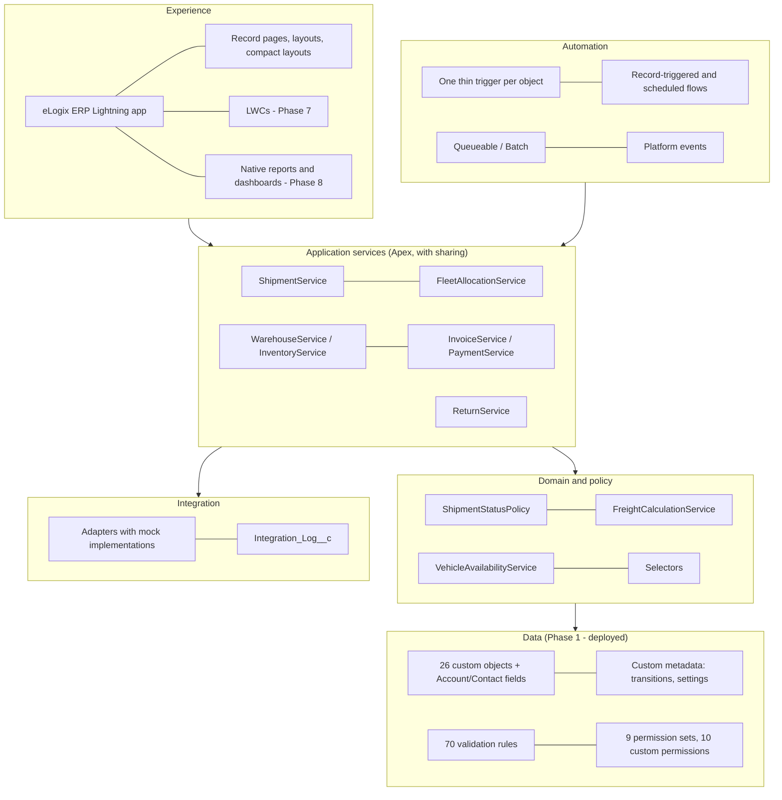
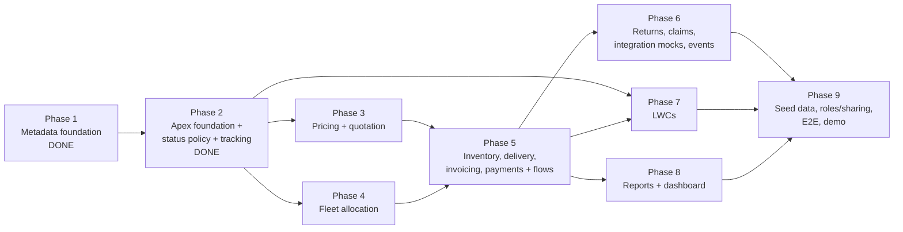

# eLogix ERP - Solution Architecture

| | |
|---|---|
| Status | Phase 1 (metadata foundation) and Phase 2 (Apex foundation, status policy, tracking) deployed and verified on 2026-11-19 |
| Target org | `eLogixDev` - Developer Edition, instance API 68.0 |
| Source API version | 67.0 (`sfdx-project.json`; kept per CLAUDE.md section 18) |
| Related | [DATA_MODEL.md](DATA_MODEL.md) · [BUSINESS_RULES.md](BUSINESS_RULES.md) · [SECURITY_DESIGN.md](SECURITY_DESIGN.md) · [SHIPMENT_LIFECYCLE.md](SHIPMENT_LIFECYCLE.md) |

## 1. Target org facts (inspected 2026-11-19)

| Fact | Value | Consequence |
|---|---|---|
| Edition | Developer Edition (production instance, not a sandbox) | No Enterprise/Unlimited-only features. Deployments that include Apex run tests as in production. |
| Data storage | **5 MB** | About 2,500 records at roughly 2 KB each. Demo data, tracking events and integration logs must stay lean (see section 6). |
| File storage | 20 MB | Enough for a handful of proof-of-delivery images; demo uses small files. |
| Multi-currency | Not enabled (`CurrencyType` unsupported) | `CurrencyIsoCode` on Business Unit is not applicable. All currency fields use the corporate currency. |
| Time zone | Org default and admin user: **Asia/Kolkata** (verified 2026-11-19) | Scheduled flows (SLA monitoring) and timestamps follow IST. |
| Corporate currency | **INR**, currency locale English (India) (verified 2026-11-19 via `UserInfo.getDefaultCurrency()`) | All currency fields display in rupees. In single-currency orgs this setting is UI-only; a fresh org needs the manual step in [DEPLOYMENT_GUIDE.md](DEPLOYMENT_GUIDE.md#4-org-settings-for-the-indian-demo). |
| Pre-existing custom metadata | None (clean org besides DE sample Account fields) | No naming collisions. |
| Other CLI-authenticated orgs | Several, including a client sandbox | Every `sf` command passes `--target-org eLogixDev` explicitly. |

## 2. Layered architecture



### Responsibilities per layer

| Layer | Owns | Must not |
|---|---|---|
| Trigger | Delegating to `<Object>TriggerHandler`. | Contain logic, SOQL or DML. |
| Trigger handler | Routing context (before/after, insert/update) to domain methods; recursion guard. | Implement business rules. |
| Domain / policy | Rules that depend on state transitions or other records (status policy, fleet conflicts, stock reservation, duplicate invoices). | Perform callouts. |
| Service | Use cases (book shipment, allocate fleet, post stock movement, generate invoice); transaction boundaries; custom permission checks; writing protected fields. | Be called from triggers for UI-only concerns. |
| Selector | All SOQL for an object, `WITH USER_MODE` unless the service has documented system-mode needs. | Contain business decisions. |
| Validation rule | Single-record invariants (see [BUSINESS_RULES.md](BUSINESS_RULES.md#ownership-model)). | Express transition or cross-record rules. |
| Flow | Declarative orchestration that business admins should be able to adjust (approvals, notifications, SLA monitoring). | Duplicate a rule already owned by Apex or a validation rule. |
| LWC / controller | Presentation, input collection, calling one service method. | Hold business logic. |

## 3. Key design decisions

| # | Decision | Rationale |
|---|---|---|
| D1 | **Metadata is generated from a model** (`scripts/node/model/*.mjs` → `npm run metadata:generate`). The generated XML is committed and remains the deployable source of truth. | Around 330 fields, 70 rules and 9 permission sets have to stay consistent: FLS coverage, picklist reuse, relationship names. The generator validates the model before writing. It catches dangling formula references, unknown picklist values, permission dependencies and percent-field misuse that the Metadata API would otherwise reject one deploy at a time. No third-party dependencies. |
| D2 | Transactional objects use **Auto Number names** mirrored into the business-key fields required by the spec (for example `Shipment_Number__c` = `Name`). Master data uses **unique External ID codes** (`Vehicle_Number__c`, `Route_Code__c`, ...). | Human-readable keys plus idempotent seeding by business key without hardcoded record IDs (CLAUDE.md section 14). |
| D3 | **Master-detail** only for owned line items and immutable audit records (items, lines, charges, tracking events, stock movements, deliveries, payments); lookup elsewhere. | Enables roll-ups and cascade semantics where ownership is real, and keeps independent records independently shareable. |
| D4 | **Roll-up summaries and formulas** derive totals (quotation totals, invoice paid/balance, shipment item count, warehouse stock). | Financial consistency by construction. For example, invoice total always equals the sum of its lines, and paid amount only counts `Completed` payments. |
| D5 | **Composite unique keys** (`Invoice_Key__c`, `Movement_Key__c`, `Event_Key__c`, `Idempotency_Key__c`, `Inventory_Key__c`). | Duplicate prevention enforced by the database even under concurrency (CLAUDE.md rule 19). Verified: a second invoice with the same key is rejected. |
| D6 | **Status transitions are data** (`Shipment_Status_Transition__mdt`, 46 records) evaluated by `ShipmentStatusPolicy`. | Configurable lifecycle without code change; permission-gated transitions declared alongside. |
| D7 | **Protected fields**: system-derived values are read-only via FLS for every role except Administrator and are written only by their owning service in system mode, after that service's custom-permission check. | Users cannot type freight amounts, stock quantities or approval stamps, and services can still maintain them. See [SECURITY_DESIGN.md](SECURITY_DESIGN.md#protected-fields). |
| D8 | **Validation bypass is a separate permission set** (`eLogix_Data_Migration`), not part of the admin set. True invariants (non-negative stock) are never bypassable. | Seed scripts can load historical records (past pickup dates) without weakening production rules. |
| D9 | Native reports and dashboards for executive analytics; LWCs for operational screens. | CLAUDE.md section 8. |
| D10 | No fflib; a lightweight in-house trigger handler / service / selector / domain split. | CLAUDE.md section 2, rule 4. |

## 4. Apex package structure (Phase 2 onward)

Built in Phase 2 (contract: [APEX_ARCHITECTURE.md](APEX_ARCHITECTURE.md); conventions: [APEX_FRAMEWORK.md](APEX_FRAMEWORK.md)):

```
force-app/main/default/classes/
  base/        TriggerHandler, ServiceResult, ELogixException, ValidationException,
               ConfigurationException, AuthorizationException
  common/      Logger, ExceptionHandler, PermissionService, SettingsService
  shipment/    ShipmentStatusPolicy, ShipmentStatusGuard, ShipmentItemsRequiredGuard,
               ShipmentDomain, ShipmentService
  tracking/    TrackingService, TrackingEventRequest
  selectors/   ShipmentSelector, TrackingEventSelector
  handlers/    ShipmentTriggerHandler
  test/        TestDataFactory + 12 test classes
force-app/main/default/triggers/   ShipmentTrigger
force-app/main/default/labels/     CustomLabels (hand-maintained)
```

The original plan listed a `BaseSelector` and an `IdempotencyKeys` class. Neither was built. Selectors are small enough not to need a base class, and idempotency keys belong to the service that owns each record type (for example, tracking keys in `TrackingService`).

Planned for later phases:

```
force-app/main/default/classes/
  pricing/     FreightCalculationService, RateCardSelector
  fleet/       FleetAllocationService, VehicleAvailabilityService
  warehouse/   WarehouseService, InventoryService
  tracking/    DeliveryService
  finance/     InvoiceService, PaymentService
  returns/     ReturnService
  integrations/ GPS, payment, accounting, mapping, notification interfaces + mocks; IntegrationLogService
  batch/ queueable/ events/
```

Salesforce DX source format allows nested folders inside a package directory. The folders are for organisation only; class names stay globally unique.

## 5. Implementation dependency graph



Critical path for the two-day plan: P1 → P2 → P3 → P5 → P8 → P9. Fleet (P4) and LWCs (P7) run alongside it.

## 6. Risks and unsupported or limited features

| Risk / limitation | Impact | Mitigation |
|---|---|---|
| 5 MB data storage | Demo data, tracking events and logs compete for about 2,500 records. | Demo data sized at about 400 records. Integration logging records failures and samples successes. Tracking events are only written for meaningful changes. A purge batch is planned for logs. |
| Validation rule messages cannot use Custom Labels | Partial deviation from CLAUDE.md rule 15. | Validation-rule messages are translatable via Translation Workbench; all Apex messages use Custom Labels. |
| Roll-up recalculation fires parent validation rules | A child insert can fail on an unrelated parent rule. | Parent rules are pure invariants. Paid-invoice immutability is owned by Apex (it compares changed fields), not a validation rule. |
| Percent fields evaluate as fractions in formulas | Found in Phase 1 verification: tax was 100x too small. | Fixed. The generator now rejects any percent field compared with or divided by 100. |
| Developer Edition dashboards | Limited dynamic dashboards. | Executive dashboard uses a fixed running user. |
| No live external systems | Integrations cannot be demonstrated live. | Interfaces with mock adapters behind Named Credentials; callouts disabled by default (CLAUDE.md section 11). |
| Multiple orgs authenticated in the CLI | Accidental deploy to a client sandbox. | `--target-org eLogixDev` is passed explicitly on every command; the default org is also `eLogixDev`. |
| Role hierarchy and sharing rules not yet deployed | Executives under Private org-wide defaults see only their own records unless a permission set grants View All. | Phase 9: roles from CLAUDE.md section 12 plus owner/criteria sharing rules. |
